# ABSTRACT

The proliferation of specialised learning platforms has left the technology student with a fragmented preparation workflow: course material is consumed on one portal, problem solving is practised on a second, résumés are assembled on a third and interview preparation on a fourth, and no single service holds the record of what the learner has actually covered. Elevora AI (Dev-Elevate) is a full-stack web application that consolidates learning, assessment, coding practice, documentation and placement preparation behind one authenticated, role-based interface.

It is implemented as a React 18 single-page application in TypeScript, bundled with Vite 7, styled with Tailwind CSS 3 and shadcn/Radix primitives, and served by an Express 5 application on Node.js. Persistence is provided by MongoDB through Mongoose 8, whose thirty-two schemas cover users, learning tracks, notes, quizzes, attempts, skill assessments, contests, submissions, video progress and notifications. Authentication is stateless: JSON Web Tokens are issued after e-mail one-time-password verification or Google OAuth, delivered in an HTTP-only cookie and verified by dedicated server middleware. Artificial intelligence is supplied by three providers, namely Google Gemini 2.0 Flash for the Study Buddy, quiz and note generation, the OpenAI interface for skill-assessment generation and evaluation, and a Groq-hosted LLaMA 3 8B model for project recommendation. Code execution is delegated to Judge0, through the RapidAPI endpoint for the practice playground and a self-hosted instance for contests, where Socket.IO broadcasts live submission updates and Elo ratings are recalculated.

The report documents the problem definition, the review of comparable systems, the specification derived from the source code, the architectural and data design, the implementation of each module and the verification evidence. Verification combined static review of the source tree, execution of the deployed client in a headless browser and manual exercise of the authentication path, and it distinguishes functionality observed to work from functionality that depends on third-party credentials, is presented by the interface but served by static data, or is specified but absent from the repository. Among the discrepancies reported are the absence of a server-side cover-letter module, hard-coded placement statistics and a mismatch between the token claims and the Socket.IO handshake that prevents socket authentication. The outcome is a working, if partially integrated, platform that consolidates twenty-three user-facing modules and forty-two API endpoint groups within a single repository that can be built and deployed with three commands.

# TABLE OF CONTENTS

| SL. NO | NAME | PAGE NO |
|---|---|---|
| 1 | INTRODUCTION | 1 |
| | 1.1   Background and Context | 1 |
| | 1.2   Problem Statement | 1 |
| | 1.3   Objectives | 2 |
| | 1.4   Scope of the System | 3 |
| | 1.5   Intended Users | 4 |
| | 1.6   Development Approach | 4 |
| | 1.7   Organization of the Report | 5 |
| 2 | LITERATURE SURVEY | 6 |
| | 2.1   Scope of the Survey | 6 |
| | 2.2   E-Learning Platforms | 6 |
| | 2.3   Online Judges and Competitive Programming | 7 |
| | 2.4   Artificial Intelligence in Education | 7 |
| | 2.5   Role-Based Access Control | 8 |
| | 2.6   Gamification and Real-Time Collaboration | 8 |
| | 2.7   Applicant Tracking Systems and Résumé Optimisation | 9 |
| | 2.8   Open Source Development as a Learning Model | 9 |
| | 2.9   Comparative Summary | 10 |
| | 2.10   Conclusion of the Survey | 11 |
| 3 | SYSTEM SPECIFICATION | 12 |
| | 3.1   System Overview | 12 |
| | 3.2   User Roles and Permissions | 12 |
| | 3.3   Functional Requirements | 13 |
| | 3.4   Non-Functional Requirements | 15 |
| | 3.5   Hardware, Software and Development Requirements | 16 |
| | 3.6   Technology Stack | 17 |
| | 3.7   External Services and Dependencies | 19 |
| | 3.8   Database and Storage Approach | 20 |
| | 3.9   Security and Privacy Considerations | 21 |
| | 3.10   Assumptions and Constraints | 22 |
| | 3.11   Feasibility Analysis | 23 |
| 4 | DESIGN | 24 |
| | 4.1   Design Principles | 24 |
| | 4.2   Overall System Architecture | 24 |
| | 4.3   Module Organisation and Component Boundaries | 25 |
| | 4.4   Use-Case Model | 27 |
| | 4.5   Data Model and Entity Relationships | 28 |
| | 4.6   Authentication and Authorisation Flow | 29 |
| | 4.7   Artificial Intelligence Request and Response Flow | 30 |
| | 4.8   Code Submission and Execution Flow | 31 |
| | 4.9   Real-Time Contest Workflow | 32 |
| | 4.10   Administration Workflows | 33 |
| | 4.11   User Interface Design | 33 |
| 5 | IMPLEMENTATION | 35 |
| | 5.1   Repository Structure | 35 |
| | 5.2   Client Routing and Application Providers | 36 |
| | 5.3   Navigation Shell and Public Interface | 37 |
| | 5.4   Server Entry Point and Middleware Pipeline | 41 |
| | 5.5   Interface Surface | 42 |
| | 5.6   Authentication and Session Handling | 43 |
| | 5.7   Role-Based Access Control Implementation | 44 |
| | 5.8   Dashboard Module | 45 |
| | 5.9   Learning Hub, Notes and Video Modules | 46 |
| | 5.10   Quiz and Skill Assessment Implementation | 46 |
| | 5.11   Artificial Intelligence Integrations and Failure Handling | 47 |
| | 5.12   Code Editor and Compiler Integration | 47 |
| | 5.13   Contest Leaderboard and Rating | 48 |
| | 5.14   Notes, Community and Technology Feed | 49 |
| | 5.15   Résumé Builder and Cover Letter Generation | 50 |
| | 5.16   Administration Console | 50 |
| | 5.17   Notifications, Productivity Tools and Search | 51 |
| | 5.18   Error Handling | 51 |
| | 5.19   Build and Deployment | 51 |
| | 5.20   Repository Screen Recording | 52 |
| 6 | RESULT AND TESTING | 54 |
| | 6.1   Evaluation Approach | 54 |
| | 6.2   Test Environment | 54 |
| | 6.3   Results of the Static Analysis | 55 |
| | 6.4   Test Cases and Observed Results | 55 |
| | 6.5   Defects and Security Findings | 59 |
| | 6.6   Limitations of the Evaluation | 61 |
| | 6.7   Discussion | 62 |
| 7 | CONCLUSION | 63 |
| | Future Enhancements   None | 64 |
| 8 | REFERENCES | 66 |

# FIGURE OF CONTENT

| FIG NO | NAME | PAGE NO |
|---|---|---|
| 4.1 | Overall system architecture of Elevora AI | 25 |
| 4.2 | Front-end module map and the corresponding server route groups | 26 |
| 4.3 | Use-case diagram for the learner, the administrator and the external services | 27 |
| 4.4 | Entity-relationship model derived from the Mongoose schemas | 28 |
| 4.5 | Authentication, token issuance and role-based authorisation flow | 29 |
| 4.6 | Request and response sequence for the AI Study Buddy | 30 |
| 4.7 | Code submission and Judge0 execution flow for practice and for contests | 31 |
| 4.8 | Real-time contest workflow over the Socket.IO channel | 32 |
| 5.1 | Sign-in screen of the deployed Elevora AI application | 37 |
| 5.2 | Public landing page of the deployed application | 38 |
| 5.3 | Interface documentation page published by the application | 39 |
| 5.4 | Project documentation page of the deployed application | 40 |
| 5.5 | Contributor guide page of the deployed application | 41 |
| 5.6 | Frame of the repository screen recording of the authentication flow | 52 |
| 5.7 | Later frame of the repository screen recording of the authentication flow | 53 |

# LIST OF TABLES

| TABLE NO | NAME | PAGE NO |
|---|---|---|
| 2.1 | Comparison of related system classes with Elevora AI | 10 |
| 3.1 | Roles and the permissions attached to them | 13 |
| 3.2 | Functional requirements, evidence and observed status | 14 |
| 3.3 | Non-functional requirements and the position observed | 16 |
| 3.4 | Technology stack, declared version and actual use | 17 |
| 3.5 | External services, credentials and degradation behaviour | 19 |
| 3.6 | Principal collections, purpose and notable fields | 20 |
| 5.1 | Directory layout of the two applications | 35 |
| 5.2 | Endpoint groups by functional area and declared protection | 42 |
| 6.1 | Environment used for the evaluation | 54 |
| 6.2 | Test cases, expected and observed results | 56 |
| 6.3 | Defects and security findings | 59 |

---

# CHAPTER – 1

## INTRODUCTION

### 1.1   Background and Context

Software education in the past decade has been shaped by a simple observation: no single tool can be good at everything, so users stopped expecting one tool to be good at everything. A student who wants to master data structures enrols on a video-course platform, migrates to a competitive programming portal to solve problems, opens a résumé template editor to produce an application document, and finally visits an internship board to look for an opening. Each of these services is individually competent and each of them is individually successful, yet the student experiences them as separate products with separate accounts, separate credentials and separate notions of progress. The consequence is that the learner's record of achievement is scattered across data silos that cannot be queried together.

This fragmentation is usually discussed in terms of convenience, but its more serious consequence is analytical. Because a course platform knows which videos were watched and a coding platform knows which problems were solved, while a résumé builder knows nothing about either, no component of the workflow can answer the questions a learner actually cares about: how much have I improved this month, which of my weaknesses is closing, and am I ready for the interview I have been invited to? A personalised recommendation is impossible without a unified view, and a personalised recommendation is precisely the capability that recent large language models have made inexpensive enough to offer at scale.

At the same time, the administrative layer of educational platforms has remained thin. A college that deploys a learning platform, a coding platform and a career portal as three separate products inherits three separate reporting pipelines, three sets of credentials to administer and three opportunities for student data to be exposed. The administrator in such an institution has no consolidated view of platform usage and no single place to moderate the community, author assessments or publish content.

Elevora AI was conceived against this background. The intent was not to build another course catalogue or another judge, but to build the shell that a student and an administrator can both live in: a single authenticated application whose modules share one identity, one progress model, one notification channel and one administrative control surface.

### 1.2   Problem Statement

The problem addressed by this project may be stated precisely as follows: to design and implement an AI-assisted learning and career-advancement platform that consolidates structured learning, timed assessment, code practice, documentation and placement preparation into a single role-based web application, in which the learner's progress is recorded once and reused by every module, and in which the administrator has a consolidated view of users, content and usage.

The problem decomposes into the following sub-problems, each of which is addressed by a specific part of the system described in this report.

. Identity fragmentation. A learner who uses five platforms must maintain five accounts. Elevora AI addresses this with a single registration and login surface offering e-mail OTP verification and Google OAuth, backed by one JWT session model.

. Progress fragmentation. Completion in one activity is invisible to the others. Elevora AI addresses this with a common user record carrying points, streaks, goals and completion counters, and with a dashboard aggregation endpoint that assembles these values from the quiz, assessment and learning collections.

. Absence of AI assistance in the learning loop. Elevora AI addresses this with three separate model integrations chosen for distinct purposes: Gemini for conversational help and content generation, OpenAI for item generation and assessment evaluation, and Groq for lightweight recommendation.

. Isolation of practice from learning. Elevora AI addresses this by embedding a Monaco-based code workspace and a contest leaderboard inside the same authenticated shell as the learning tracks.

. Lack of administrative consolidation. Elevora AI addresses this with a dedicated administration console exposing user management, course authoring, quiz authoring, community moderation, analytics, system logs and configuration.

### 1.3   Objectives

The objectives of the project are stated below. Each objective is later mapped to the requirement identifiers of Chapter 3 and to the implementation evidence of Chapter 5, so that the extent to which it has been met can be assessed rather than asserted.

. O1. To consolidate the major functions of a learning and career platform into one authenticated, role-based web application with a single navigation shell.

. O2. To provide structured learning tracks with module and topic level progress tracking that is persisted on the server.

. O3. To provide an AI assistance surface for doubt resolution and for the generation of quizzes and notes.

. O4. To provide a working code workspace with multi-language execution and a competitive contest mode with a live leaderboard and rating.

. O5. To provide automated skill assessment with scored feedback and a generated improvement plan.

. O6. To provide career-document tooling in the form of a résumé builder with applicant-tracking-system scoring and a cover-letter generator, both exporting to PDF.

. O7. To provide a peer community with administrative moderation.

. O8. To provide an administration console with user, content, assessment, analytics, log and configuration management.

. O9. To secure the system with token-based authentication, role checks, input sanitisation and rate limiting on sensitive operations.

. O10. To document the system to academic reporting standard, including design diagrams derived from the implemented code rather than from an abstract ideal.

### 1.4   Scope of the System

The scope covers the complete repository hosted at the MrAlpha00/Dev-Elevate address, comprising a client application of approximately three hundred and seventeen source files under the Client directory and a server application of one hundred and seven hand-written JavaScript files under the Server directory. The functional scope comprises twenty-three user-facing modules grouped as learning, assessment, career, community and productivity, together with nine administration modules.

The following boundaries are declared explicitly so that the claims of this report may be read against them.

- The system is a web application. No native mobile client exists in the repository, and no offline synchronisation mechanism is implemented.

- Payment processing is out of scope as implemented. The client contains a plan comparison screen and links to externally hosted checkout pages; the server contains no payment provider integration, no payment route and no payment model.

- Video content is not hosted by the platform. The video module integrates with the YouTube Data interface and stores only progress and bookmark state.

- The cover-letter module is a client-side document generator. No server-side storage, retrieval or validation of cover letters exists in the inspected repository.

- Placement statistics are demonstration data held in a server-side constant rather than in a database collection.

- No automated unit or integration test suite is present in either package; the verification described in Chapter 6 is therefore manual and code-level.

### 1.5   Intended Users

The primary user of the system is a student in the final two years of an undergraduate engineering or computer science programme who is preparing for a campus placement drive. This user needs a single view of the syllabus covered, a measurable record of practice, and application documents that can be produced in minutes rather than hours. A second category is the self-taught learner or career switcher who has no institutional curriculum and therefore requires an explicit roadmap. A third is the competitive programmer who needs an execution environment and a ranked contest. A fourth is the institutional administrator, typically a course coordinator, who requires visibility of activity and the ability to moderate content.

The interface reflects these four profiles. The learner receives a dashboard centred on points, streaks, goals and progress; the administrator receives a separate console reached through a distinct route branch and guarded by a role check; the contestant is offered a dedicated workspace; and the self-learner is offered the roadmap and placement modules.

### 1.6   Development Approach

The project was developed as two independently deployable applications. The client is a single-page application in which routing, state and data access are handled by React Router, four React contexts and a small number of service modules that wrap the Axios HTTP client. The server is a stateless REST application in which each functional area is represented by a route file that declares its endpoints, a controller file that holds the business logic, and one or more Mongoose schema files that declare the persisted shape of the data. This separation is visible in the repository as a consistent convention across all thirty route modules, twenty-four controllers and thirty-two models, and it allows a reviewer to trace any endpoint from its HTTP path to the collection it writes to.

Authentication was designed as a stateless bearer-token scheme rather than as a server-side session store, which keeps the API horizontally scalable and allows the same identity to be presented to the REST layer, the file-upload layer and the WebSocket layer. Authorisation is expressed as two middleware functions: one that establishes the identity of the caller and one that compares the role stored in the database record against the role required by the route.

The development of the artificial-intelligence features followed a different pattern. Rather than implementing a single provider abstraction, each model was introduced where its characteristics were most useful: Gemini for conversational response generation, the OpenAI interface for structured item generation and evaluation of skill assessments, and Groq for short recommendation prompts that must return quickly in the browser. This decision has the advantage of matching each provider's cost and latency profile to the interaction, and the disadvantage of distributing the failure modes across three separate credential sets, which is discussed in Chapter 6.

### 1.7   Organization of the Report

The remainder of the report is organised in the conventional order of a software engineering project report. Chapter 2 reviews the classes of existing system that the project draws upon and compares their characteristics with those of Elevora AI. Chapter 3 states the system specification, including the functional and non-functional requirements, the technology stack, the external dependencies and the assumptions on which the design rests, together with a requirement traceability table that records the observed status of each requirement. Chapter 4 describes the design, presenting the architecture, the role model, the data model, the principal workflows and eight diagrams derived from the implemented code. Chapter 5 describes the implementation module by module, with the directory layout, the routing table, the endpoint groups, the data models, the client-side modules and the build and deployment procedure, supported by genuine screenshots of the running application. Chapter 6 reports the verification work, the test plan, the test cases with their observed results, and the limitations that were discovered during evaluation. The conclusion summarises the contribution of the project and separates what was achieved from what remains to be done.

# CHAPTER – 2

## LITERATURE SURVEY

### 2.1   Scope of the Survey

The literature relevant to this project spans several distinct literatures. The first is the literature on electronic learning platforms and on the integration of artificial intelligence with instruction. The second is the literature on programmatic problem solving and online judging, which supplies the execution model behind the code workspace. The third is the literature on role-based access control, which supplies the authorisation model. The fourth is the literature on gamification and real-time collaboration, which supplies the motivational and communication models used by the contest and progress features. The fifth is the practical literature on applicant tracking systems, which supplies the evaluation criteria of the résumé scanner. Finally, the open source contribution literature provides the context in which the project is developed and licensed.

Because the project is an implemented system rather than an experimental study, the sources used in this survey are of two kinds: peer-reviewed and pre-print publications for the conceptual claims, and the official technical documentation of each framework and external service for the implementation claims. Where a publication could not be verified from an accessible record, it is identified as such in the reference list rather than being presented as established.

### 2.2   E-Learning Platforms

Massive open online course providers such as Coursera, edX and Udemy, and open-course consortia such as the OpenCourseWare movement, have established the modern expectations of an electronic learning system: a browsable catalogue, self-paced video or reading material, an assessment instrument, and a record of completion. Their strength is breadth and the quality control that a large instructional team can apply. Their limitation, for the purpose of this project, is that the catalogue is a closed body of content. The learner cannot ask why a given construct works, cannot generate a practice instrument on an adjacent topic, and cannot transfer the record of what was studied into an employment document. The distinction that matters for Elevora AI is not quality but generativity: the learning content of a platform is authored once, whereas the content of an assisted platform can be produced on demand.

A second class of learning platform is the interactive curriculum platform, of which Codecademy and Exercism are representative, in which the learner writes code inside the page that teaches it. These systems close the gap between instruction and practice that the course platform leaves open, and they are the direct precedent for the code workspace of Chapter 5. Their remaining limitation is that the exercise set is fixed and, in the case of most such systems, is confined to a single language.

### 2.3   Online Judges and Competitive Programming

Online judging systems provide the execution substrate for programming education. Judge0, the service used by this project, was conceived as an infrastructure layer rather than a user interface: it exposes a submission interface, an execution sandbox with configurable limits on CPU time and memory, and a polling interface that returns the compilation status, standard output, standard error and resource consumption of a completed run. This separation between judging infrastructure and pedagogy is important, because it allows the educational value to be added independently of the sandbox.

Contest platforms such as Codeforces, LeetCode and HackerRank add to this substrate the elements of competition: a fixed time window, a scoring rule that combines solved problems with penalties for failed attempts, and a rating system that orders participants across contests. The rating mechanism used by Elevora AI is the Elo system, developed for competitive chess and subsequently applied to rating systems in many domains, in which each participant's rating changes by a quantity proportional to the expected score against the actual score. The parameter used in the implementation is 32, the value that Elo himself used in the original chess tables for periods of a month or more.

### 2.4   Artificial Intelligence in Education

The most significant development in the literature relevant to this project is the shift from rule-based intelligent tutoring systems to systems built on large language models. Mollick and Mollick have summarised the practical prompt patterns that make a general purpose model behave as a tutor, and their central observation is relevant to the design of this project: a model used as a tutor must be prompted into a constrained pedagogical role rather than permitted to answer freely. The Elevora AI chatbot satisfies this partially by requiring the user to select a query category, which constrains the system prompt, and by rendering the reply through a Markdown renderer with syntax highlighting so that code remains legible in a learning context.

A second strand of the literature concerns automated assessment. Item generation with a language model, followed by a second model pass that evaluates the learner's answers, is a known design pattern for formative assessment at scale, and it is the pattern used by the skill-assessment module, in which OpenAI generates a domain-specific question set, stores it with the learner's responses, and returns a score together with a generated improvement plan. The literature also raises the well-known reliability concern that a generative model may produce items that are ambiguous, that are answerable by inference rather than by knowledge, or that are duplicated across candidates. The implementation in this project mitigates only the last of these, by storing the generated items in the database with the attempt, so that the instrument actually administered is reproducible; it does not implement item review, distractor analysis or inter-rater agreement, and this is recorded as a limitation in Chapter 6.

The third strand concerns the placement of a model inside an application. The architecture used in this project routes conversational generation through the server, so that the provider credential remains on the server, but routes the project recommender directly from the browser to the Groq service, so that the credential is embedded in the delivered bundle. This asymmetry is a deliberate engineering trade-off in terms of latency, and it is a security weakness in terms of credential custody, as discussed in Sections 3.8 and 6.5.

### 2.5   Role-Based Access Control

The access control model of the system follows the role-based access control formalisation of Sandhu, Coyne, Feinstein and Youman, in which permissions are attached to roles, users are assigned roles, and a session is evaluated against the permissions of the roles it activates. The formalism separates the concepts of user, role, session and permission, which allows an access control requirement to be stated in terms of the roles that may activate it. In the implementation the two roles are user and administrator, the session is the JSON Web Token issued at authentication, and the permission check is performed by two middleware functions, one that establishes identity and one that compares the role.

The literature on web security is relevant to the observation that identity establishment and authorisation are distinct obligations and that the second is meaningless without the first. In the inspected server, several route groups apply only the authorisation check without first establishing identity; because the authorisation check reads the role from the identity object that the first check populates, such routes are permanently denied rather than insecurely open. The reverse error also occurs, in which a route group omits both checks. These observations are the subject of the security analysis of Section 3.9 and the test cases of Chapter 6.

### 2.6   Gamification and Real-Time Collaboration

Gamification is the application of game design elements in a non-game context. Hamari, Koivisto and Sarsa reviewed a substantial body of empirical work on the subject and concluded that the effects of gamification are mixed and strongly dependent on the context in which the elements are applied; that is, gamification is not inherently effective, but is effective where the element is congruent with the activity it decorates. The features of Elevora AI that employ such elements are the daily streak counter, the points total, the achievement badges, the contribution leaderboard and the competitive contest. The congruence argument applies most strongly to the contest, which is competitive in its own right, and weakly to the points total, which is a measure of activity rather than of learning.

Real-time collaboration in educational systems is usually implemented with the WebSocket protocol or with a library built upon it. Socket.IO, the library used here, adds a transport upgrade mechanism, automatic reconnection and a room abstraction that maps a logical group of clients onto a shared broadcast channel. The contest module of this project uses exactly that abstraction: each contest occupies a room named from the contest identifier, clients join and leave that room, and the server broadcasts the current participant count and the status of each judged submission to the members of the room.

### 2.7   Applicant Tracking Systems and Résumé Optimisation

The applicant tracking system occupies a decisive position in modern recruitment practice. A résumé that is rejected by an automated screen is never read by a recruiter, and the screens in question are parsers that extract structured fields from a document and compare them against the requisition and the keyword set of the advertisement. The engineering implication for a résumé builder is that the document must be both attractive to a human reader and legible to a parser, which is a genuine tension, since the human reader is best served by a two-column layout with visual hierarchy while the parser is best served by a single-column document with conventional headings.

The Elevora AI résumé builder resolves this tension by generating two documents from a single data model: a styled preview intended for human reading and a plain, single-column variant intended for machine parsing, together with a scanner that reports keyword coverage against a general keyword set and role-specific keyword sets. The scanner is a deterministic keyword analysis, not a machine-learning classifier, and its output should be read as coverage guidance rather than as a prediction of screening outcome.

### 2.8   Open Source Development as a Learning Model

The project is developed and published as an open source repository with a contributor guide, a code of conduct and a security policy. Pinto, Steinmacher and Gerosa studied the population of casual contributors to open source projects and found it to be considerably larger and more diverse than is commonly assumed, and that the principal barriers to contribution are motivational and procedural rather than technical. The contributor guide published by the application addresses exactly those barriers: it defines the meaning of the various difficulty labels attached to issues, distinguishes the repository from an unrelated project of similar name, and lists the classes of issue suitable for a first contribution. The relevance of this literature to the project is direct, because the platform exists partly to attract such contributions and the contributor-facing screens are part of the delivered interface.

### 2.9   Comparative Summary

Table 2.1 summarises the classes of system reviewed above and compares their characteristics with those of Elevora AI. The comparison is deliberately made at the level of capability rather than of branding, and the right-hand column reflects the state of the implementation as established by the inspection reported in Chapters 4 to 6 rather than the ambition stated in the project synopsis.

**Table 2.1: Comparison of related system classes with Elevora AI**

| System class | Principal strength | Principal limitation | Elevora AI as implemented |
| --- | --- | --- | --- |
| Video course platforms (Coursera, edX, Udemy) | Broad authored catalogue, asynchronous delivery | No embedded code execution, no AI tutoring, no career documents | Learning Hub and Video modules give module progress, but the catalogue is smaller and the AI assistance is limited to the Study Buddy |
| Interactive curriculum platforms (Codecademy, Exercism) | Instruction and practice in one surface | Single language focus, fixed exercise set, no assessment or placement tooling | Monaco workspace with multi-language Judge0 execution, but the practice problem set is local static data |
| Online judges and contest platforms (Codeforces, LeetCode, HackerRank) | Reliable sandboxed execution, ranking, established community | No structured curriculum, no résumé or interview preparation | Contest module reproduces execution, scoring and Elo rating, but problems are declared in the model rather than harvested from a database |
| AI tutoring systems and assistants | On-demand explanation, generated practice material | Typically unintegrated with progress records; credential custody is often weak | Gemini for the Study Buddy and for quiz and note generation, OpenAI for assessment; the Groq key is exposed in the client bundle |
| Résumé and cover-letter builders (Zety, Novoresume, Canva) | Document design, templates, immediate export | No skill tracking, no ATS analysis, no connection to preparation activity | Résumé builder with ATS scan and dual export; the cover letter has export but no ATS variant and no server persistence |
| Applicant tracking systems and job boards (LinkedIn, Naukri) | Employer connectivity, workflow integration | Do not teach; do not measure preparation | Placement module and ATS scanner provide preparation, not employer connectivity |
| Developer communities (Stack Overflow, Discord) | Peer knowledge exchange at scale | Weak coupling to formal curricula and to progress tracking | Community forum with answers, resolution marking and administrative moderation |

### 2.10   Conclusion of the Survey

The survey shows that each capability required by this project is available separately and well implemented in the state of the art, and that the value of the consolidation is not in any single capability but in the shared context between them. It also shows that consolidation is not free: the literature on gamification cautions that merged features dilute their effect, the literature on role-based control cautions that merged privilege sets widen the consequence of a single authorisation mistake, and the security literature makes the obvious point that a larger attack surface produces more places in which a credential may be exposed. Elevora AI consequently treats consolidation as an engineering problem to be managed rather than an accumulation to be displayed, and the remainder of this report documents how that management was performed.

# CHAPTER – 3

## SYSTEM SPECIFICATION

### 3.1   System Overview

Elevora AI is specified as a three-tier, service-oriented web application with a browser-resident presentation tier, an application tier that exposes a stateless REST interface together with a WebSocket channel, and a document data tier. The presentation tier is a single-page application in which every functional module is mounted inside one application shell, so that the authenticated session, the notification channel, the theme state and the navigation are shared by every module without duplication.

The application tier is organised around the resource that each route group manages. Each functional area of the specification has a corresponding route module that declares its endpoints and its middleware requirements, a corresponding controller that holds the business logic, and a set of Mongoose schemas that declare the persisted form of the data. The data tier is MongoDB, reached through the Mongoose object document mapper, which permits the schema of a collection to evolve without a migration, an advantage for the document-shaped artefacts of this system such as quiz items, contest problems and learning notes.

Four classes of external service are integrated. Three are inference services, used respectively for conversation, assessment and recommendation. One is a compiler service, used to execute submitted source code. Two are content services, used to supply course metadata and current news. One is a messaging service, used to deliver verification and password-reset mail. Each integration is optional at run time: the system starts, serves its static and unauthenticated resources, and degrades the corresponding module when the credential for a provider is absent.

### 3.2   User Roles and Permissions

Two roles are defined. A registered learner holds the role user and may exercise every module of the application shell. An administrator holds the role admin and may additionally exercise the administration console, the authoring endpoints and the moderation endpoints. The role is stored on the user document, is copied into the issued token, and is re-read from the database on every authenticated request, so that a change of role takes effect without requiring the user to re-authenticate.

**Table 3.1: Roles and the permissions attached to them**

| Capability | Anonymous | User (learner) | Admin |
| --- | --- | --- | --- |
| View public landing, legal and documentation pages | Permitted | Permitted | Permitted |
| Register, verify by OTP, log in, log in with Google | Permitted | Permitted | Permitted |
| Access the application shell and all learner modules | Denied | Permitted | Permitted |
| Submit and attempt quizzes and skill assessments | Denied | Permitted | Permitted |
| Write, publish and share notes and community content | Denied | Permitted | Permitted |
| Manage learners, courses, quizzes and community content | Denied | Denied | Permitted |
| Read analytics, system logs and system settings | Denied | Denied | Permitted |
| Change system settings | Denied | Denied | Permitted, with a secondary secret-key check |

The permission model is enforced in three places. The presentation tier routes the administration branch through a guard component that checks the role held in the client-side session and redirects an unauthorised caller. The application tier applies an identity middleware and, where required, an authorisation middleware to the individual endpoints. The data tier is not separately protected, because no user-facing query accepts an identifier belonging to another user without an ownership test in the controller; the ownership test is present for the notes, progress, review, assessment and attempt resources and is absent for some of the administrator resources, where it is unnecessary.

### 3.3   Functional Requirements

The functional requirements are derived from the route table of the server and the route table of the client, and are therefore traceable to an implementation. The status column records the state observed during the inspection described in Chapters 4 to 6. Four values are used: Implemented, where the behaviour exists in the source and was observed to work; Implemented, credential dependent, where the behaviour exists but requires a third-party credential or a running database; Partially implemented, where the endpoint group exists but some part of the behaviour is static, hard-coded or defective; and Not implemented, where the capability described in the project synopsis has no server-side counterpart.

**Table 3.2: Functional requirements, evidence and observed status**

| ID | Requirement | Primary evidence | Status |
| --- | --- | --- | --- |
| FR-01 | Register with e-mail address, name and password; verify the account by a one-time password sent over SMTP | userRoutes.js; userController.registerUser, verifySignupOtp; utils/mailer.js; OtpToken model | Implemented, credential dependent |
| FR-02 | Authenticate with e-mail and password, or with a Google identity token | AuthContext.tsx; userController.loginUser, googleUser; firebase.ts | Implemented |
| FR-03 | Issue a signed token at authentication and present it on subsequent requests | authMiddleware.authenticateToken; axiosinstance.ts request interceptor | Implemented (see NFR-09) |
| FR-04 | Restrict administration functionality by role | ProtectedRoute component; requireAdmin and authorize middleware | Implemented, with exceptions (see Section 6.4) |
| FR-05 | Display a dashboard summarising points, streak, goals, progress, recent attempts and achievements | dashboardRoutes.js; dashboardController.js; Dashboard component group | Partially implemented (static seed values on the client) |
| FR-06 | Follow structured learning tracks for DSA, Java, MERN and AI/ML with module progress, notes and reviews | javaRoutes, aimlRoutes, mernRoutes, dsaRoutes; Notes, Reviews and Progress models | Implemented |
| FR-07 | Attempt author-written quizzes with timing, scoring and a history of attempts | quizRoutes.js; userQuizRoutes.js; Quiz and QuizAttempt models | Implemented |
| FR-08 | Generate a quiz on a chosen topic and difficulty | aiController.generateAIQuiz; AIQuizGenerator component | Implemented, credential dependent |
| FR-09 | Generate a skill assessment across five domains, submit answers and receive a scored evaluation with an improvement plan | assessmentController.js (TRACK_CONFIG); assessmentRoutes.js; SkillAssessment model | Implemented, credential dependent |
| FR-10 | Write source code in an embedded editor, run it and read compiler output | CodeEditor.tsx; ProblemsPage.tsx; compilerRoutes.js | Implemented, credential dependent |
| FR-11 | Participate in a timed contest with a live leaderboard and a rating | contestController.js; socket.js; Contest, Problem and ContestSubmission models | Implemented, credential dependent (see Section 4.8) |
| FR-12 | Ask the AI Study Buddy for help on learning, career or general questions | Chatbot.tsx; aiRoutes.js; aiController.getAIReply | Implemented, credential dependent |
| FR-13 | Create, edit, publish, search, like and attach files to notes | notesRoutes.js; notesController.js; Notes model | Partially implemented (the like operation fails on a schema mismatch) |
| FR-14 | Ask and answer questions in a community forum with resolution marking and acceptance of an answer | communityRoutes.js; Question and Answer models | Implemented |
| FR-15 | Build a résumé from structured forms, scan it for applicant-tracking-system compatibility and export it | ResumeBuilder components; atsRoutes.js; atsController.js; utils/keywordExtractor.js | Implemented, credential dependent (scan) |
| FR-16 | Compose and export a cover letter | CoverLetter.tsx (jsPDF export) | Implemented on the client only; no server-side module exists |
| FR-17 | Follow a career roadmap by role or by skill | Roadmap.jsx; assets/json/rolebasedRoadmaps.json and skillbasedRoadmaps.json | Implemented (static data) |
| FR-18 | Read current technology news and career updates | newsRoutes.js; newsAggregator.js (NewsAPI); TechFeed component | Implemented, credential dependent |
| FR-19 | Track video progress, bookmark videos and resume a course | videoProgressRoutes.js; VideoProgress and SavedVideo models | Implemented |
| FR-20 | Search across the platform | utils/search.ts; utils/semanticSearch.js | Implemented on the client only |
| FR-21 | Receive in-application notifications and read or delete them | notificationRoutes.js; Notification model; NotificationContext | Implemented |
| FR-22 | Administer users, courses, quizzes, community content, feedback, analytics, logs and settings | adminRoutes.js; adminCourseRoutes.js; adminFeedbackRoutes.js; analytics.js; SystemSettingRoute.js | Partially implemented (see Section 6.4) |
| FR-23 | Take a paid subscription for premium features | PremiumPage.tsx; PaymentPage.tsx | Not implemented as a server-side capability; the client links to externally hosted checkout pages and the server contains no payment route or model |

### 3.4   Non-Functional Requirements

The non-functional requirements are stated as design obligations, and the measured position is reported only where a measurement was actually taken. No response-time target, throughput figure or availability guarantee is asserted, because the repository contains no load-test evidence, and the deployed application could not be exercised with a measurable concurrent workload during this evaluation.

**Table 3.3: Non-functional requirements and the position observed**

| ID | Requirement | Design obligation | Position observed |
| --- | --- | --- | --- |
| NFR-01 | Usability | A single navigation shell of nineteen modules shall be reachable from every authenticated page | Met: the sidebar and navbar expose the same nineteen entries and the catch-all route resolves unknown paths to the dashboard |
| NFR-02 | Maintainability | The server shall separate route declaration, business logic and persistence | Met by convention across thirty route modules, twenty-four controllers and thirty-two models |
| NFR-03 | Portability | The client shall build and run without platform-specific code | Met: the build completed and the client was served from a static host in the evaluation environment |
| NFR-04 | Accessibility | Interactive controls shall carry labels and be keyboard reachable | Partially met: the editor registers keyboard shortcuts, but no formal accessibility audit was performed |
| NFR-05 | Availability of optional integrations | Absence of a third-party credential shall not prevent the application from starting | Met: the client and the server start without any provider credential; the affected module reports an error |
| NFR-06 | Data model flexibility | New fields shall be persistable without a schema migration | Met by the use of the document data model, at the cost of the schema discipline discussed in Section 3.8 |
| NFR-07 | Real-time responsiveness | Contest submission state shall be broadcast to the participants of a contest | Implemented in code; not observed in operation because the socket handshake does not resolve the user (Section 4.8) |
| NFR-08 | Input hygiene | Text submitted by users shall be sanitised before it is stored or rendered | Partially met: a sanitising middleware is applied globally, but the validator module is not attached to any route |
| NFR-09 | Session integrity | Every authenticated request shall carry an identity that the server can verify | Defective: the client interceptor and the session context use two different storage keys, so the bearer token is not attached (Section 6.3) |
| NFR-10 | Credential custody | No provider credential shall be delivered to the browser | Not met: the Groq and Gemini keys are inlined into the client bundle by the build tool (Section 3.9) |

### 3.5   Hardware, Software and Development Requirements

The development of the project requires a workstation capable of running the client build, a Node.js runtime, a MongoDB instance and an editor with support for the two languages used. The following requirements are stated for the development environment; the runtime requirements of the deployed system are substantially smaller.

- A 64-bit workstation with at least 8 GB of memory and 10 GB of free disk space; the client dependency tree occupies approximately 400 MB and the server approximately 100 MB.

- Node.js version 20.19 or later, which is the version required by the Vite 7 bundler used by the client. The client manifest declares a lower bound, which is insufficient for the bundled toolchain.

- A MongoDB instance, either local or hosted, reachable through a connection string supplied in the environment. The server terminates the process if the connection fails.

- A Chromium-based browser for the client and an SMTP account for the verification and password-reset messages.

- Third-party credentials for the inference services, the compiler service, the YouTube interface and the news interface, each of which may be absent for local development at the cost of the corresponding module.

The deployment requirements are a static host for the client and a Node.js host for the server. The client deployment configuration observed in the repository specifies a build command, an output directory and a rewrite rule that sends every unmatched path to the single-page entry point.

### 3.6   Technology Stack

Table 3.4 records the technology stack with the version declared in the lockfile and the purpose that each component actually serves in this repository. Where the project synopsis names a technology that the inspected code does not use, the discrepancy is recorded in the final column.

**Table 3.4: Technology stack, declared version and actual use**

| Layer | Component | Version | Purpose in this system |
| --- | --- | --- | --- |
| Client | React / React DOM | 18.3.1 | Component model for nineteen modules and the administration console |
| Client | TypeScript | 5.5.3 | Type discipline across 181 TSX and 36 TS source files |
| Client | Vite | 7.1.12 | Development server, hot replacement and production bundling |
| Client | React Router DOM | 7.12.0 | Client-side routing and route guarding |
| Client | Tailwind CSS | 3.4.1 | Utility styling and the design token set (electric, neon, cyber palettes) |
| Client | Radix UI and shadcn primitives | 1.1 – 2.2 | Accessible dialog, tab, select, dropdown and toast primitives |
| Client | Monaco Editor | 0.53.0 | In-browser code editing with language services |
| Client | Axios | 1.11.0 | HTTP access to the application tier, with an interceptor that attaches the bearer token |
| Client | Socket.IO client | 4.8.1 | Contest room membership and live updates |
| Client | jsPDF and html2pdf.js | 4.0.0 / 0.14.0 | Résumé and cover-letter PDF export |
| Client | Firebase SDK | 12.4.0 | Google identity token acquisition on the client |
| Client | Stripe libraries | 18.3.0 / 7.6.1 | Declared but not used to create a payment session; the client links to externally hosted payment pages |
| Server | Node.js with Express | 5.2.1 | REST interface, middleware pipeline, static file serving |
| Server | Mongoose and the MongoDB driver | 8.16.4 / 6.20.0 | Persistence of thirty-two collections |
| Server | jsonwebtoken | 9.0.2 | Token signing and verification |
| Server | bcrypt and bcryptjs | 6.0.0 / 3.0.2 | Password hashing and comparison |
| Server | Socket.IO | 4.8.1 | Contest rooms, participant counts, submission updates |
| Server | OpenAI SDK | 4.104.0 | Skill-assessment item generation and evaluation |
| Server | Nodemailer | 7.0.11 | One-time-password and password-reset mail over SMTP |
| Server | PDFKit | 0.17.1 | Generation of interview, system-design and cheatsheet guides in a separate service on port 3001 |
| Server | sanitize-html | 2.17.0 | Global input sanitisation middleware |
| Server | express-rate-limit | 8.1.0 | Throttling of the password-change endpoint |
| External | Google Gemini 2.0 Flash | API | Study Buddy replies, quiz generation, note generation (invoked from the server and, in one path, from the client) |
| External | OpenAI model (configurable) | API | Skill-assessment questions and scoring |
| External | Groq, LLaMA 3 8B | API | Project recommendations, called directly from the browser |
| External | Judge0 | API | Compilation and execution of submitted source code |
| External | YouTube Data API v3 | API | Course metadata and video catalogue |
| External | NewsAPI | API | Technology news aggregation |

Two discrepancies between the project synopsis and the inspected code deserve statement. The synopsis attributes the conversational assistant to Gemini and the assessment engine to the OpenAI interface with GPT-4; in the code the assessment model is named by an environment variable and the conversational assistant is served through a backend route that proxies to Gemini 2.0 Flash, so the functional allocation in the synopsis is broadly correct. The synopsis, however, lists the cover letter and the payments integration as features of the platform. The cover letter exists only as a client component with a browser-side export, and no payment integration exists on the server at all; the server's subscription module is a newsletter sign-up that stores an e-mail address.

### 3.7   External Services and Dependencies

The dependencies of the system on external services are summarised in Table 3.5 together with the behaviour observed when the corresponding credential is absent. This table is central to the verification chapters, because it explains why several modules could not be exercised end to end in the evaluation environment.

**Table 3.5: External services, credentials and degradation behaviour**

| Service | Used by | Credential | Behaviour when absent or unreachable |
| --- | --- | --- | --- |
| Gemini inference | aiController.js for the Study Buddy, quiz and note generation | GEMINI_API_KEY | The request fails and the error object is returned to the client; no alternative provider is attempted |
| OpenAI inference | assessmentController.js and dashboardController.js | OPENAI_API_KEY and the model name | Assessment generation fails; the dashboard falls back to three hard-coded project suggestions |
| Groq inference | utils/groqAPI.ts, called from the browser | VITE_GROQ_API_KEY | The client helper falls back to a locally generated response |
| Judge0 through RapidAPI | compilerRoutes.js for the practice workspace | RAPID_API_KEY | Compilation does not occur and no result is returned |
| Judge0, self-hosted | contestController.js for contest submissions | JUDGE0_API_URL, JUDGE0_API_KEY and JUDGE0_HOST | Submissions cannot be graded and the leaderboard does not advance |
| YouTube Data v3 | utils/youtubeService.js and adminCourseController.js | YOUTUBE_API_KEY | The service returns a built-in mock catalogue of courses |
| NewsAPI | newsAggregator.js and the latest-news handler in userController.js | NEWS_API_KEY | The feed endpoint returns an error status |
| SMTP over Gmail | utils/mailer.js for verification and reset messages | MAIL_USER and MAIL_PASS | Registration cannot be completed and the password-reset link cannot be delivered |
| MongoDB | config/db.js | MONGO_URI | The server logs the failure and terminates |
| Firebase client | utils/firebase.ts for the Google identity flow | VITE_FIREBASE_* variables | The Google sign-in button cannot complete the exchange |

### 3.8   Database and Storage Approach

The data tier is a document database accessed through the object document mapper. Thirty-two schemas are defined, of which twenty-nine are reachable from a route or a controller; three are declared and never imported, and one is an empty file that defines no schema at all. The principal collections and their relationships are summarised in Table 3.6 and are drawn in the entity-relationship diagram of Figure 4.4.

**Table 3.6: Principal collections, purpose and notable fields**

| Collection | Purpose | Principal fields |
| --- | --- | --- |
| User | Account, credential and gamification state | name, email, password hash, role, googleId, streak, points and goal counters |
| OtpToken | One-time passwords for registration and password reset | email, otp, purpose, expiry, verification flag |
| Notes | User notes, shared notes and generated notes | userId, title, content, topicId, topicName, isAiGenerated, tags, isPublic, files, likes, views |
| Reviews, Progress | Per-topic ratings and completion state in the learning tracks | userId, topicId, rating, comment, completed, timestamps |
| Course, LearningModule, AdminCourse | Course catalogue, module structure and administrator-authored course records | courseId, title, description, modules, youtube metadata, module order |
| Quiz, QuizAttempt | Authored instruments and the learner's responses | title, topic, difficulty, questions, answers, score, totalQuestions, timeTaken, completedAt |
| SkillAssessment | Generated assessments and evaluations | track, questions, answers, score, accuracy, skillLevel, improvements, roadmap |
| Contest, Problem, ContestSubmission | Contest definition, problem statements and judged submissions | title, startTime, status, problems, statement, testCases, difficulty, status, points, penalty, attempts |
| VideoProgress, SavedVideo | Watch position and bookmarks | userId, videoId, courseId, watchedSeconds, completed |
| Question, Answer | Community discussions | question, answers, accepted answer, resolved flag |
| Notification | In-application alerts | userId, message, type, read |
| AdminLog, SystemSettings, Feedback, Faq, ContactSupport, Subscriber, VisitingWebsite | Administration, configuration and ancillary records | action, adminId, settings key and value, content, email, count |

Three properties of the storage approach are worth recording. First, the schema of a collection is declared in code and enforced by the mapper at run time, with unknown fields discarded by default; this strictness is the direct cause of the defect in the note-liking operation reported in Section 6.4, in which the route writes a field that the schema does not declare. Second, several collections carry compound indexes on the user identifier and the topic identifier, and on the visibility and topic pair, which are the access patterns of the notes listing. Third, file attachments are stored on the file system of the server and are served as static content from a dedicated path, with the metadata held in the notes collection; this choice avoids placing binary data in the document store but requires that the server file system be writable and that it be shared if the server is replicated.

### 3.9   Security and Privacy Considerations

The system stores personal data of three kinds: credentials and identity data, learning and assessment activity, and free-text content created by users. The following controls are present in the code.

- Passwords are hashed with a memory-hard key derivation function before storage and compared in constant time by the library.

- Tokens are signed with a secret held in the environment and are delivered in a cookie declared HTTP-only and secure, with a same-site policy and a three-day expiry.

- Every mutating and reading route that exposes personal data requires an authenticated identity, and the routes that expose administrative resources additionally require the administrative role.

- All request bodies, query strings and route parameters pass through a sanitising middleware that removes unsafe markup before the value reaches a controller.

- The password-change endpoint is throttled by a dedicated rate limiter.

- Updates to the system configuration additionally require a secondary secret supplied in a header, which separates the configuration operation from ordinary administrator activity.

The following weaknesses were identified and are reported honestly rather than omitted.

- Two provider credentials are compiled into the browser bundle, because the build tool inlines every variable prefixed for client exposure. Any visitor can extract them and use them at will. The correct remedy is to proxy these calls through the server, as the conversational path already does.

- A signing secret is committed in a utility script at the root of the client directory, and a news service credential appears as a literal in the server source. Neither value is reproduced in this report, and both should be rotated and removed from the repository.

- The administration feedback group and the compiler, the conversational and the résumé-scanning endpoints are reachable without authentication, which exposes them to anonymous use.

- The socket handshake resolves the user from a claim that the login token does not contain, and admits the connection when resolution fails, so that the real-time channel carries no authenticated identity.

- The cookie is declared secure unconditionally, which prevents the session from being established over plain HTTP in a local development environment.

- The application trusts forwarded protocol headers unconditionally, which weakens the address-based logic of the rate limiter when the service is deployed behind a proxy that does not overwrite the header.

### 3.10   Assumptions and Constraints

- A MongoDB instance is available and reachable; the design does not provide for a relational alternative.

- The inference services continue to expose the interfaces used by the code, namely a content generation endpoint for Gemini and a chat completion endpoint for the OpenAI and Groq compatible interfaces.

- A Judge0-compatible service is available with the language identifiers assumed by the code, in particular the identifiers for C, C++, Java, Python and JavaScript.

- The browser environment supports the modern JavaScript and CSS features used by the client and the editor.

- For the deployment to function as a whole, the client and the server must be reachable under a single origin, or a proxy rule must be configured; the deployment configuration observed in the repository rewrites every unmatched path to the client entry point and therefore does not, by itself, proxy the interface paths to the server.

### 3.11   Feasibility Analysis

The project is technically feasible within the stated constraints. Every component it depends upon is either a freely available library or a documented commercial interface, and the architecture requires no capability that is not present in the inspected runtime. The volume of code, approximately forty-two hundred files in total, is at the upper end of what a small team can maintain but is consistent with the open source contribution model that the project adopts.

The project is economically feasible in the sense that its running cost is dominated by the free tiers of the third-party services and by a static host and a small application host for the server. The principal cost exposure is the inference services, which are metered per token or per request.

The project is operationally feasible for its intended scale. The observed operational weaknesses are concentrated in configuration rather than in design, and the majority of them are corrected by a small number of changes: aligning the client storage keys, adding the identity middleware to the three unprotected route groups, reconciling the token claims with the socket handshake, and moving the two browser-exposed provider credentials behind the server.

# CHAPTER – 4

## DESIGN

### 4.1   Design Principles

The design of Elevora AI follows five principles that were applied consistently in the source and that are visible in the structure of the repository.

. One shell, many modules. The application shell owns the session, the navigation, the notification channel and the theme. A module is added by registering a route and, where required, a navigation entry; it does not introduce a second shell.

. Identity once, applied everywhere. A single token, issued once, is understood by the route guard on the client, by the identity middleware on the server, by the file-upload path and by the socket handshake. This is the principle that the defect discussed in Section 4.8 violates.

. The server decides. Every mutation is performed by the server, which owns the authorisation check, the ownership test and the persistence. The client owns presentation and, in the documented exceptions of the résumé and cover-letter modules, the local document state.

. Graceful degradation at the boundary. A module whose external service is unavailable reports an error rather than preventing the application from loading; the exception is the practice workspace, whose compiler endpoint has no fallback.

. No code without a route. Every persistent entity in the data model is reachable from an endpoint, except for the three orphaned schemas, which are recorded as such in Table 3.6.

### 4.2   Overall System Architecture

Figure 4.1 presents the overall architecture of the system as three horizontal bands. The upper band is the presentation tier: the single-page application with its nineteen learner modules, the embedded code workspace, the conversational panel, the administration console and the socket client. The middle band is the application tier, in which the route groups are shown in the grouping actually used by the server. The lower band is the data tier, in which the principal collections are grouped by the functional area that owns them. Beneath these, a fourth band represents the external services with which the application tier and, in two documented cases, the presentation tier communicate directly.

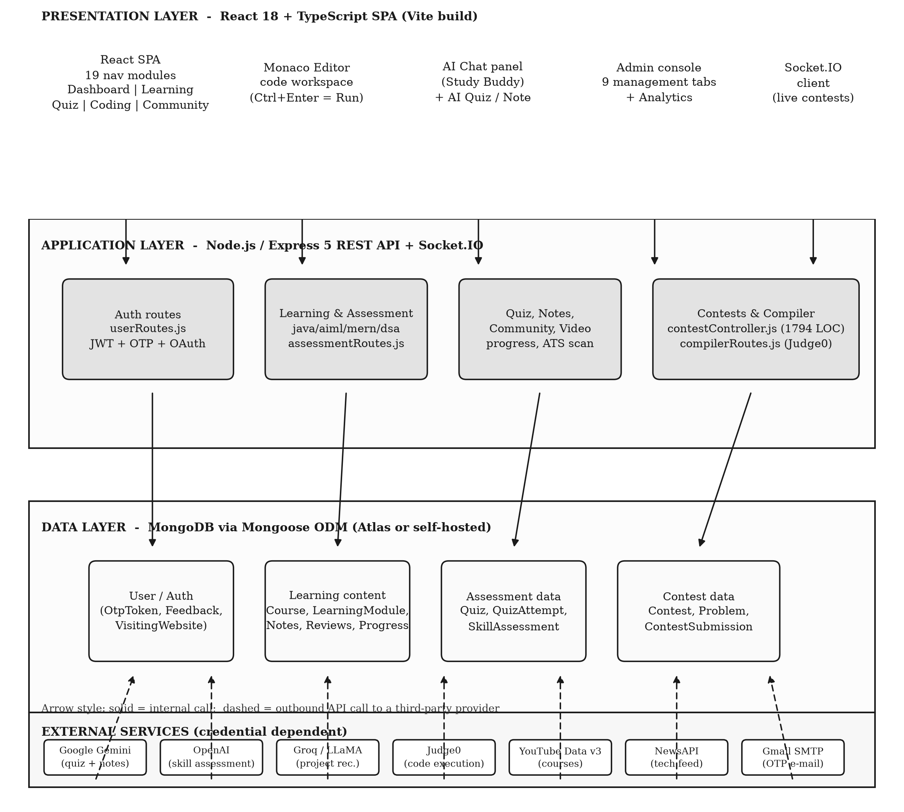

*Fig. 4.1: Overall system architecture of Elevora AI*

Three characteristics of the architecture deserve comment. The application tier is stateless with respect to the client, which permits any number of instances behind a load balancer; the only server-side session state is the file system that holds note attachments. The presentation tier communicates with the application tier through three channels: the HTTP interface for request and response, the WebSocket channel for contest events, and the static path for note attachments. The third characteristic is that the diagram does not show the single-page rewrite in the deployment configuration, which sends unmatched paths to the client entry point; the consequence of that configuration for the interface paths is discussed in Section 6.3.

### 4.3   Module Organisation and Component Boundaries

The client is organised by feature rather than by layer. The pages directory holds the routed screens, the components directory holds the shared and feature-specific components, the contexts directory holds the four providers that carry cross-module state, the services directory holds the modules that wrap the HTTP client, and the api directory holds the thin endpoint wrappers used by the administration and assessment screens. Figure 4.2 maps the nineteen navigation entries to their functional groups and to the server route group that serves each one, and it marks the two groups for which the server provides no support.

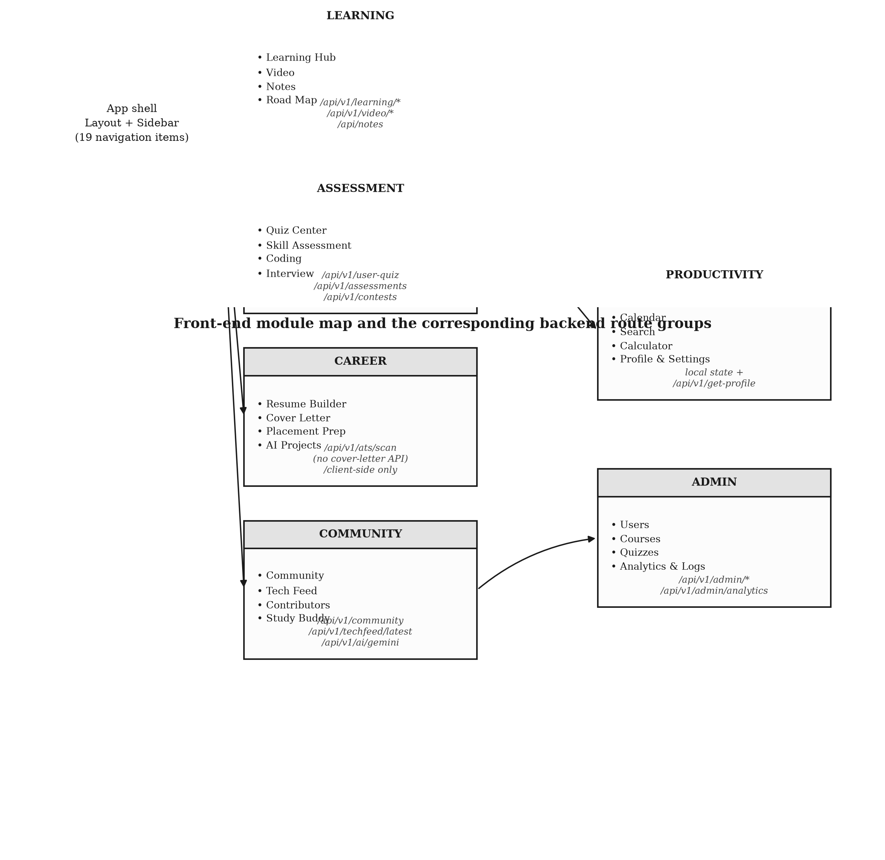

*Fig. 4.2: Front-end module map and the corresponding server route groups*

The server follows a matching convention. A functional area has one route file, one or more controller files and one or more model files. The route file declares the mount path relative to the application root, the HTTP method, the middleware chain and the handler. The controller holds the logic and owns the interactions with the models and with the external services. The model declares the schema, the indexes and, where the schema benefits from it, the virtual properties. This convention is followed consistently by the thirty route modules, which is why a reader can move from the API documentation published by the application to the implementing file in a single step.

### 4.4   Use-Case Model

Figure 4.5 states the use-case model of the system. The learner actor performs sixteen use cases, grouped in the figure into registration and profile management, learning, assessment, code practice, contest participation and community participation. The administrator actor performs six use cases, all of which are drawn inside the administration boundary. The external services actor is connected to the code practice use case, because the execution of a submitted program is delegated to the compiler service rather than performed by the platform.

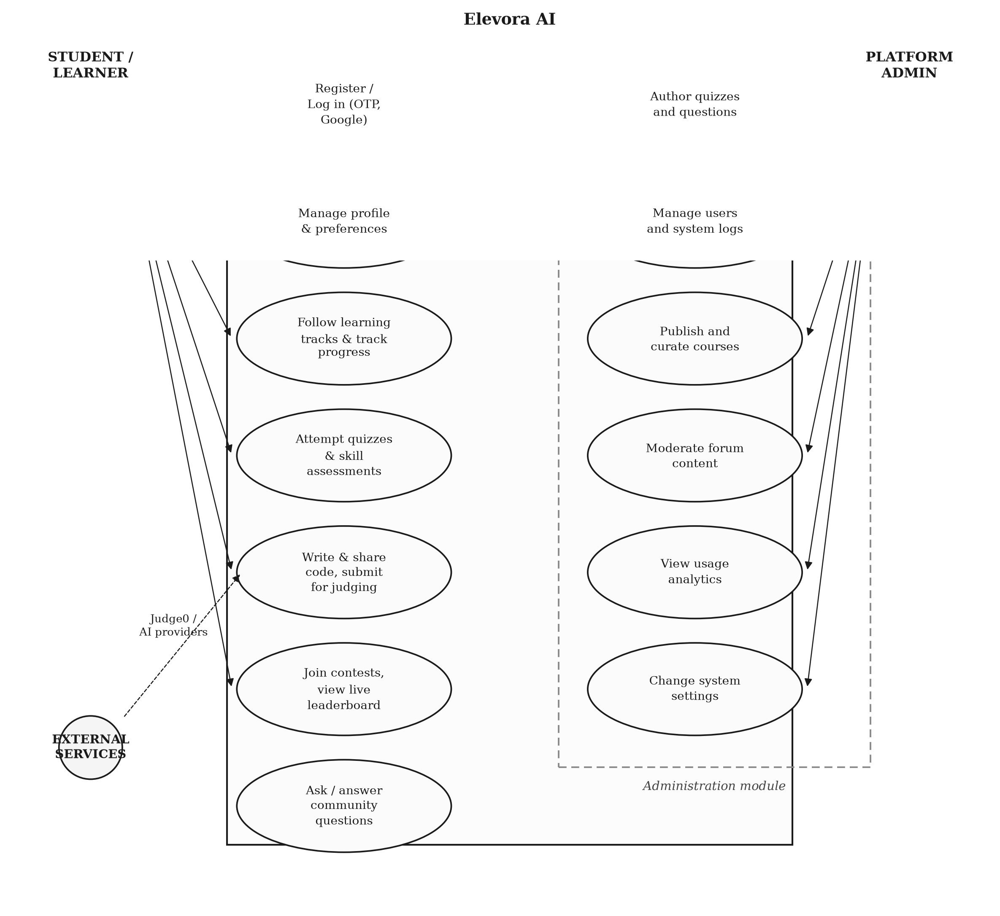

*Fig. 4.3: Use-case diagram for the learner, the administrator and the external services*

The use-case model clarifies an important boundary of the system. The platform does not itself place the learner in employment: the placement module supplies prepared material and links, and the résumé and cover-letter modules produce documents, but no recruitment workflow is implemented. Similarly, the community module implements question and answer exchange with resolution marking and acceptance, but no messaging or notification between members beyond the general notification channel is provided.

### 4.5   Data Model and Entity Relationships

The entity-relationship diagram of Figure 4.4 is derived directly from the Mongoose schemas. The diagram shows the eleven entities that are the subject of reference relationships and omits the remaining collections, which are independent of the others.

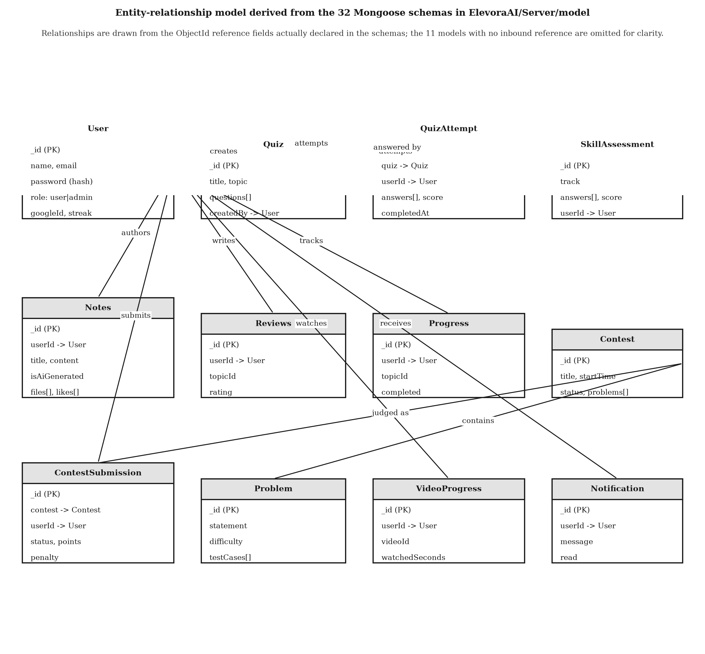

*Fig. 4.4: Entity-relationship model derived from the Mongoose schemas*

The central entity is the user, to which the notes, the reviews, the progress records, the quiz attempts, the skill assessments, the contest submissions, the video progress records and the notifications are all attached. The quiz and the contest form two further aggregate roots, each with a child collection that records a completed activity: an attempt for a quiz and a submission for a contest. The remaining entities are weak in the sense that they have no independent lifecycle.

Two modelling decisions are worth recording. The note entity carries an array of user identifiers for the likes and a virtual property that exposes the count of those identifiers; the property is declared as a getter only, with no setter, which is correct for a derived value but means that the route that attempts to assign to it fails at run time. The contest submission entity carries both the number of attempts and the accumulated penalty, which are computed by the controller at judging time and stored, so that the leaderboard can be computed without recomputing the scoring rule.

### 4.6   Authentication and Authorisation Flow

Figure 4.5 shows the flow of the authentication and authorisation processes. Two paths reach a token: the registration path, in which a one-time password is mailed to the applicant and verified against the stored token record, and the credential path, in which the password is compared with the stored hash. A third path, the Google path, exchanges an identity token obtained by the client library for a session token. All three issue a token whose payload contains the user identifier and the role.

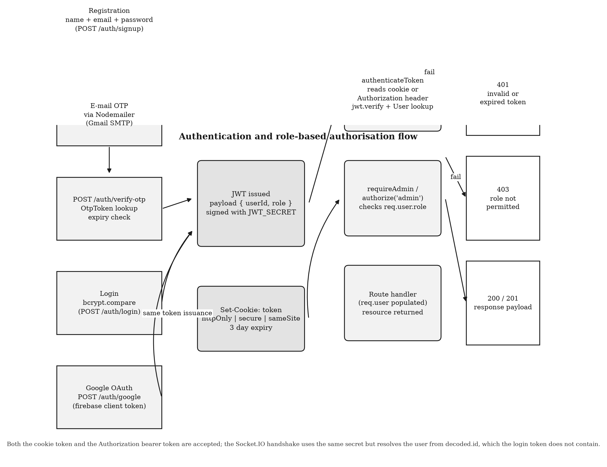

*Fig. 4.5: Authentication, token issuance and role-based authorisation flow*

On each subsequent request the identity middleware reads the token from the cookie or from the authorization header, verifies the signature, loads the user record with the password excluded, and attaches the record to the request. The authorisation middleware then compares the role in that record with the role the route requires, and rejects the request with a status of 401 when the identity is absent or invalid and 403 when the role is insufficient. The design intent is that identity is always established before authorisation is evaluated; the inspection identified route groups that invert this order, and the consequence is recorded in Section 6.4.

### 4.7   Artificial Intelligence Request and Response Flow

The artificial-intelligence features of the system are reached in three ways. Figure 4.6 traces the conversational path, in which the learner types a question in the Study Buddy panel, the client posts it to the server route, the controller forwards it to the Gemini content generation interface with the provider key taken from the environment, and the reply is returned to the browser and rendered as Markdown with syntax highlighting.

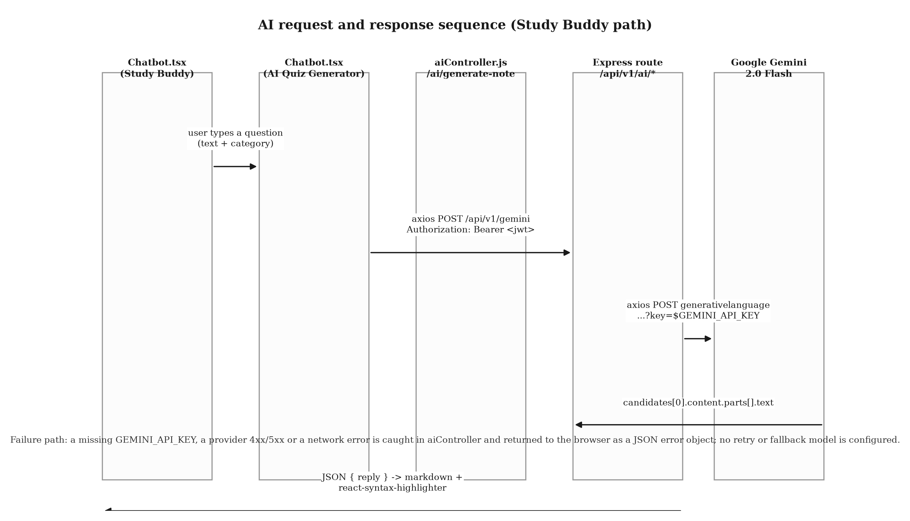

*Fig. 4.6: Request and response sequence for the AI Study Buddy*

The generative path differs in that the output is stored rather than displayed. When the learner requests a generated quiz, the controller builds a prompt from the requested topic, difficulty and question count, sends it to the provider, parses the returned items, assembles a quiz document with its questions and returns it, after which the learner may attempt it through the ordinary quiz interface and the resulting attempt is scored against the stored items. The note-generation path is analogous: the generated text is stored as a note with the flag that identifies it as machine-generated, so that it can be listed separately from the learner's own material.

The assessment path is the most structured of the three. The controller holds a configuration table of five tracks, each of which specifies the domain, the number of items and the prompt template, and it uses the OpenAI interface to generate the items and, in a second pass, to evaluate the learner's answers and produce a score, an accuracy, an identified set of weaknesses and a generated improvement plan. The generated instrument and the responses are both persisted with the attempt, which makes the evaluation reproducible.

### 4.8   Code Submission and Execution Flow

Figure 4.7 describes the two execution paths of the system. The practice path begins in the embedded editor, where the learner writes source code in one of the supported languages and triggers the run or submit action with the keyboard or with the toolbar. The client base64-encodes the source, selects the numeric language identifier from a local table, and posts the pair to the compiler route of the server. The route forwards the request to the Judge0 instance exposed through a public application programming interface aggregator, with the synchronised wait option so that the response carries the result of the run.

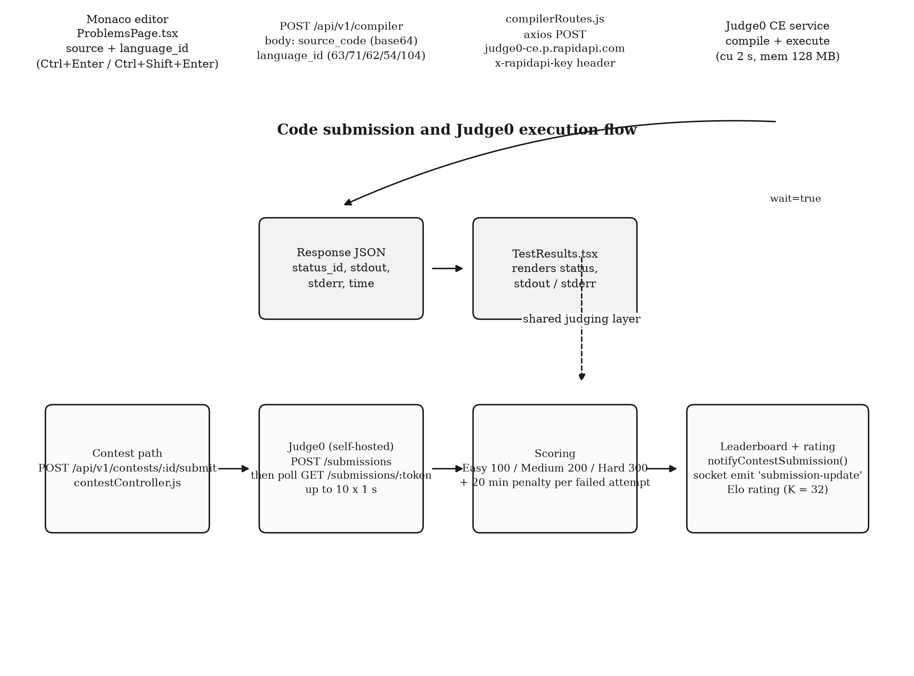

*Fig. 4.7: Code submission and Judge0 execution flow for practice and for contests*

The contest path is more elaborate. The submission is accepted only when the contest is open and the participant is registered, the source is posted to the configured Judge0 instance, and the server polls for the result at intervals of one second for up to ten attempts. The grading rule awards a fixed number of points according to the difficulty of the problem and adds a penalty of twenty minutes for each previous failed attempt on the same problem. The outcome is stored as a submission document and is broadcast to the contestants of the room.

The design contains one inconsistency that the evaluation confirmed: the practice path and the contest path use different Judge0 endpoints, different authentication mechanisms and different waiting strategies, and the practice path additionally hard-codes the host and port of the server rather than deriving it from the configured interface base address. Consequently the run button of the practice workspace cannot succeed in a deployed environment in its present form, as recorded in Chapter 6.

### 4.9   Real-Time Contest Workflow

The contest module is the only part of the system that uses the WebSocket channel. Figure 4.8 shows the workflow. The client establishes a socket connection, presenting a token in the handshake, and then emits an event that causes it to join the room named for the contest. The server maintains the participant count for the room and broadcasts it. When a submission is judged, the controller notifies the socket layer, which emits an event carrying the contest identifier, the participant, the problem and the status to every member of the room.

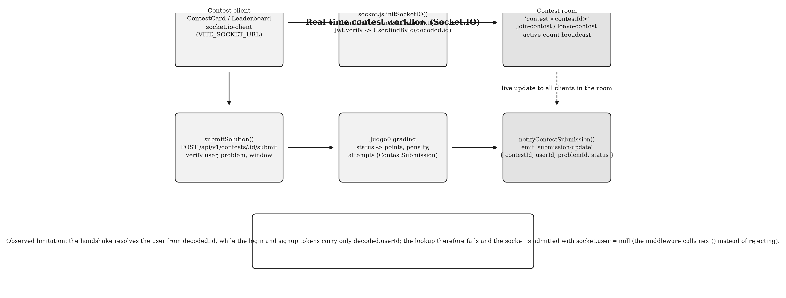

*Fig. 4.8: Real-time contest workflow over the Socket.IO channel*

The handshake middleware in the server is intended to bind the socket to an authenticated user by verifying the token presented in the handshake and loading the corresponding user record. The implementation resolves the user from a claim named as the identifier, whereas the tokens issued by the registration, verification, credential and Google paths carry only a claim named as the user identifier. The lookup therefore fails, the middleware catches the failure and admits the connection with a null user rather than rejecting it. The practical consequence is that the room membership and the broadcast mechanism operate correctly, while the identity of the socket is not established; this is reported in Chapter 6 as a defect with a specified correction.

### 4.10   Administration Workflows

The administration console is mounted on a distinct branch of the client route table and renders nine modules: an overview, user management, content management, community moderation, news updates, quiz management, analytics, system logs and system settings, together with a feedback module. The server supports these with four route groups: the administration group for users and system logs, the administration course group for authored course records and the import of course metadata from the video service, the administration quiz group for the authoring of quizzes and questions and the retrieval of submissions, and the analytics group for the aggregate statistics and their export as a delimited text file.

The settings module is the most sensitive of the nine, because it controls whether the platform accepts new registrations and whether it is placed in maintenance mode. Its update operation requires the administrator role and, in addition, a secondary secret supplied in a header, which is a form of two-factor authorisation that depends on a shared secret rather than on a second credential. The audit trail is provided by the system log collection, which records the administrator, the action and the timestamp of each recorded operation.

### 4.11   User Interface Design

The interface follows the design system described by the client configuration. A utility-first stylesheet with four extended colour scales supplies the visual language; a component library of headless primitives supplies accessible dialog, tab, select, dropdown, label and alert behaviour; and a small utility module merges conditional class names. The application supports a dark theme whose state is held in a global context and persisted in the browser.

Three interface decisions are worth recording because they affect the responsiveness of the design. The navigation appears twice, once as a persistent sidebar on wide screens and once as a collapsible menu in the top bar on narrow screens, and the two menus are constructed from the same list of entries, so that a new module appears in both. The code workspace uses a split layout in which the editor, the problem description and the result panel are independently scrollable, which is appropriate for the fixed viewport of a coding contest but is cramped on a small screen. Finally, the client is not code-split: every routed screen is imported statically by the route table, including three components of more than fifty kilobytes each, so that the initial bundle carries the whole application. This is a performance defect, recorded in Chapter 6.

# CHAPTER – 5

## IMPLEMENTATION

### 5.1   Repository Structure

The project is a single repository containing the documentation, the client application and the server application. The client occupies the Client directory and the server the Server directory; the two are independent packages with their own manifests, their own lockfiles and their own dependency trees, and neither imports the other. Table 5.1 gives the directory layout of the two applications together with the purpose of each significant directory.

**Table 5.1: Directory layout of the two applications**

| Path | Contents | Purpose |
| --- | --- | --- |
| Client/src/pages | 13 page directories and 2 page files, including Landing, Dashboard, Coding, Notes, Interview, Placements, Roadmap, Assessments, AiModel | The routed screens of the application |
| Client/src/components | 23 sub-directories and about 115 files | Feature components: Dashboard, Layout, Auth, Quiz, ResumeBuilder, CoverLetter, Community, TechFeed, LearningHub, Admin, Chatbot, Payment, calendar, Calculator, ProjectRecommender, Profile, Settings, tasks, ui primitives |
| Client/src/contexts | 6 context providers | Session, global application state, administration state, socket connection, notification queue and calculator history |
| Client/src/api, src/services, src/features | 4 API modules, 4 service modules and one query slice | HTTP access layers: shared Axios instance, administration, assessment, dashboard, video progress, analytics and courses |
| Client/src/utils, src/lib, src/config, src/data, src/types | 11 utilities, one class utility, one route configuration, seed data and type declarations | Provider clients, semantic search, résumé templates, the interface base address and shared types |
| Client/public, Client/src/assets | Favicon, an animated globe graphic, a logo, twelve course and notes data files, two roadmap data files | Static assets and the bundled static content |
| Server/controller | 24 controller files, about 6,800 lines | Business logic for authentication, contests, assessments, notes, dashboard, courses, quizzes, community, the scanner and the support modules |
| Server/routes | 30 route files, about 3,400 lines | Endpoint declaration, middleware chains and mount paths |
| Server/model | 32 schema files, about 1,400 lines | Persistence declarations |
| Server/middleware | 4 files | Identity, authorisation, sanitisation and validation helpers |
| Server/utils, Server/config | 10 utility modules and one database module | Provider clients, mail templates, keyword sets, the rating calculator, the rate limiter and the database connection |
| Server root | index.js, socket.js, pdfServer.js and three utility scripts | Application entry point, socket initialisation, a separate document-generation service and one-off maintenance scripts |

Two structural observations are relevant to the maintenance of the project. The notes module implements its handlers directly in the route file, which is 662 lines long, while a controller of 625 lines that exports the same eleven operations exists and is imported only for its file-upload middleware; the two implementations have diverged, and the divergence is the cause of the defect described in Section 6.4. The server also contains three schema files that are never imported and one empty file that declares no schema; these are harmless but misleading to a reader who navigates the model directory.

### 5.2   Client Routing and Application Providers

The client router is declared in the application root file, which imports every routed screen statically and assembles them into four branches. The first branch contains the public pages: the landing page, the privacy, cookie and terms policies, the disclaimer, the creator page, the interface documentation, the project documentation and the contributor guide. The second branch contains the three authentication pages, each of which is explicitly marked as not requiring a session. The third branch is the administration console, which is wrapped in both a session guard and an administration guard. The fourth branch is a catch-all that mounts the application shell and declares the twenty-eight learner routes beneath it, with an unmatched path redirected to the dashboard.

Four providers wrap the router. The global provider holds the application-wide state, including the theme and the user summary, and persists it in the browser under a single key. The session provider implements registration, verification, credential login, Google login, the forgotten-password flow and logout, and persists the session under a second key. The socket provider establishes the real-time connection. The notification provider maintains the queue of user-visible alerts. A splash screen is shown until the window load event has fired, with a timeout as a fallback, which prevents the layout from flickering during the initial load.

The route guard is a small component that accepts two properties. The first declares whether a session is required and the second whether the administration role is required; the component consults the session context, redirects an unauthenticated visitor to the sign-in page, and renders the administration branch only for a caller whose role matches. The guard is therefore the client-side expression of the permission model of Table 3.1, and the server-side expression of the same model is the identity and authorisation middleware.

### 5.3   Navigation Shell and Public Interface

The navigation shell presents the same nineteen entries in the sidebar and in the mobile menu, in the order Dashboard, Learning Hub, Video, Quiz Center, Skill Assessment, Coding, Interview, Study Buddy, Tech Feed, Community, Resume Builder, Cover Letter, Placement Prep, AI Projects, AI Models, Road Map, Notes, Calendar and Contributors. Each entry carries an icon and a route, and the shell renders the routed screen inside a main region with a footer and a back-to-top control.

Figure 5.1 shows the sign-in screen of the deployed application. The screen presents the credential form, a forgotten-password link, a Google sign-in button and a registration link, and it also renders a block of demonstration administrator credentials in plain text, which is a security weakness discussed in Section 6.5. The screen was captured from the deployed host with a headless browser; no credential was entered in order to obtain it.

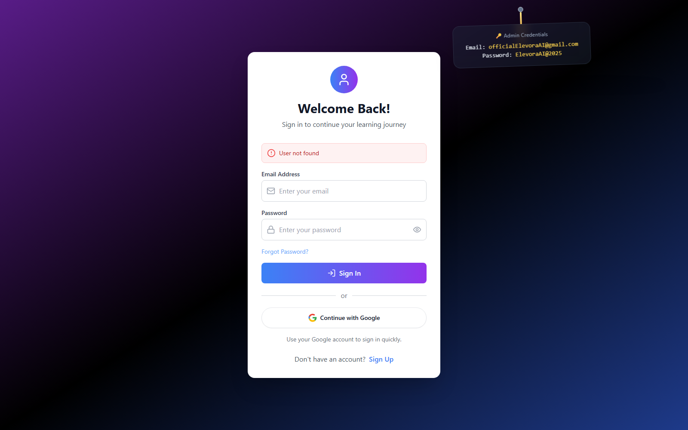

*Fig. 5.1: Sign-in screen of the deployed Elevora AI application*

Figure 5.2 shows the public landing page of the same deployment. The page composes a hero section, a statistics band, a feature grid that describes the principal modules, a technology section, testimonials, a frequently asked questions section and a call to action, with an animated three-dimensional cube and a cookie-consent banner. The statistics displayed on this page, which advertise a learner population of more than fifty thousand, are marketing statements carried in the component source; they are not derived from any collection and are not verified by this report.

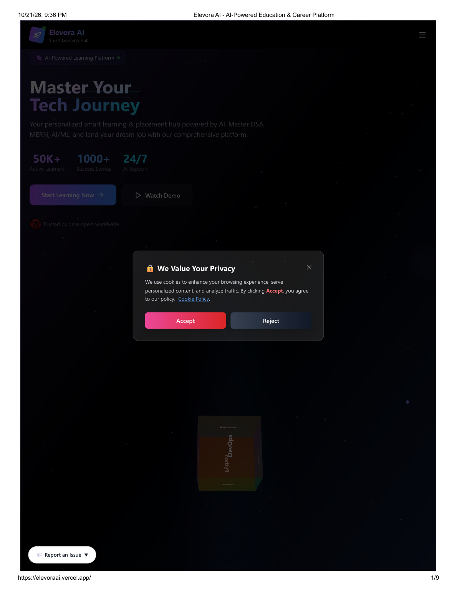

*Fig. 5.2: Public landing page of the deployed application*

Figure 5.3 shows the interface documentation page published by the application. The page lists the endpoint groups of the server with their methods and descriptions, and is generated from a static table in a component rather than from the route table of the server. It is nevertheless a faithful summary of the implemented interface, and it is included here as evidence of the documented public surface.

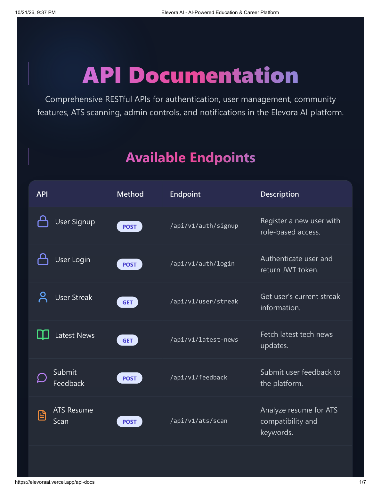

*Fig. 5.3: Interface documentation page published by the application*

Two further public pages are shown in Figures 5.4 and 5.5. The project documentation page summarises the architecture, the technology stack and the contribution process for prospective contributors, and the contributor guide page explains the difficulty labels used on the issue tracker and the procedure for a first contribution. Both are part of the open-source development model described in Section 2.8.

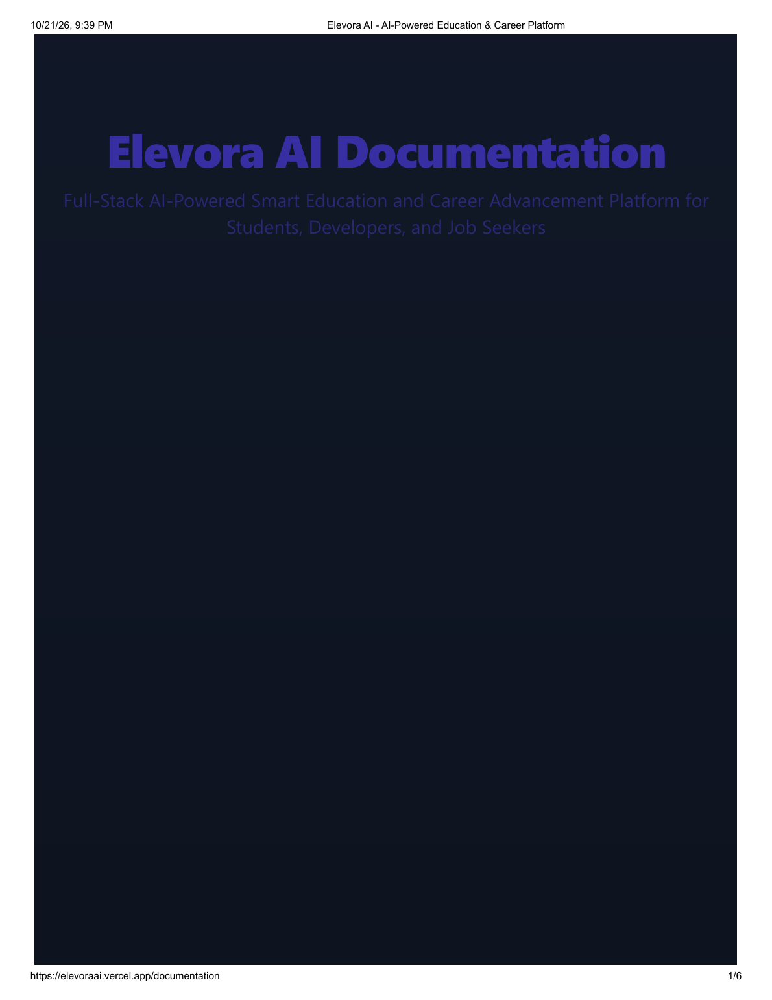

*Fig. 5.4: Project documentation page of the deployed application*

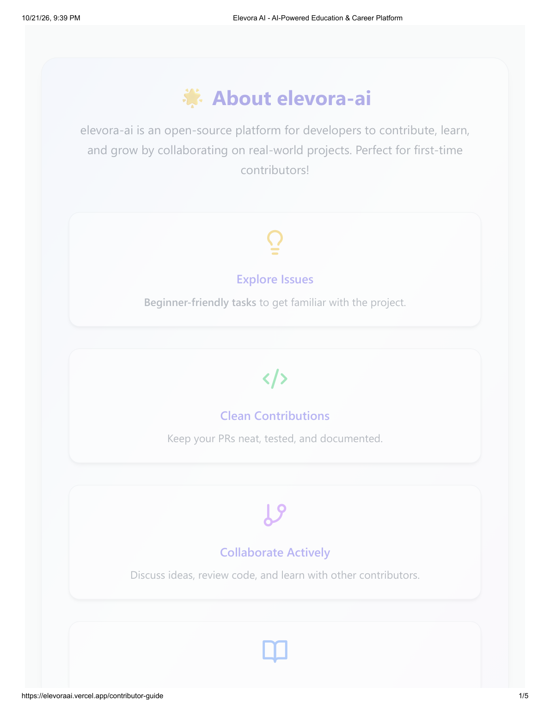

*Fig. 5.5: Contributor guide page of the deployed application*

### 5.4   Server Entry Point and Middleware Pipeline

The server entry point establishes the connection to the database before the listener is opened, and refuses to start if the connection fails. It then installs the middleware pipeline in a fixed order: cross-origin resource sharing with the configured client origin and with credentials permitted, the body parser, the cookie parser, and the sanitising middleware. The route modules are then mounted at thirty-one distinct prefixes, which include the learner, administration, assessment, learning, compiler, placement, contest, notes, notification and support groups. A static path serves the note attachments, a global error handler converts an uncaught exception into a JSON response, and a catch-all returns a JSON document for an unmatched path.

Two implementation details in the entry point deserve mention. The listener is replaced by a wrapper that creates a Node HTTP server around the application, which is the mechanism by which the socket server attaches to the same port. The route table also contains two duplicated mounts: the assessment routes are mounted at two prefixes and the conversational routes at one prefix twice, which means that only the first of each pair is reachable. The duplication is harmless in itself, but it inflates the documented interface and suggests that the intended set of prefixes is wider than the effective one.

### 5.5   Interface Surface

Table 5.2 groups the endpoints of the server by functional area and states the authentication requirement of each group as declared in the route files. The table is the implementation-level counterpart of the requirement table of Chapter 3.

**Table 5.2: Endpoint groups by functional area and declared protection**

| Group | Prefix | Protection declared in the route file | Notes |
| --- | --- | --- | --- |
| Authentication | /api/v1/auth and /api/v1 | Public for signup, verification, login, Google exchange, forgotten and reset password; authenticated for logout and profile | Issues the token and the session cookie |
| Administration | /api/v1/admin | Authenticated and administrator role for users, logs and settings; the system-log creation route requires authentication only | The system-log route is accessible to any signed-in user |
| Administration feedback | /api/v1/admin/feedback | None declared | List, review-status and delete operations are reachable anonymously |
| Administration quiz | /api/v1/admin/quiz | Authenticated and administrator role applied to the whole router | Quiz and question authoring, submission listing |
| Administration analytics | /api/v1/admin/analytics | Authenticated and administrator role | Aggregate counts and a delimited-text export |
| Learner quiz | /api/v1/user-quiz | Authenticated | Attempting and history of attempts |
| Assessment | /api/v1/assessment and /api/v1/assessments | Authenticated | Generation, submission, history and latest summary; the second prefix is unreachable |
| Dashboard | /api/v1/dashboard | Authenticated | Aggregate summary of the learner |
| Learning tracks | /api/v1/learning/java, aiml, mern, dsa | Authenticated | Modules, notes, reviews and progress; the catalogue is declared in the route files |
| Video | /api/v1/video | Authenticated | Progress, continuation, course progress and bookmarks |
| Courses | /api/v1/courses and /api/v1/admin-courses | Administrator role declared for the write operations; the role check is applied without the identity check | The write operations are therefore always denied |
| Community | /api/v1/community | Authenticated | Questions, answers, resolution marking and answer acceptance |
| Notes | /api/notes | Public for browsing, searching and topic retrieval; authenticated for the personal operations | Handlers implemented in the route file |
| Notifications | /api/v1/notifications | Authenticated | Listing, read marking, deletion |
| Contests | /api/v1/contests | Authenticated except for the contest listing | Registration, submission, leaderboard, rating and results |
| Compiler | /api/v1/compiler | None declared | Forwards to the Judge0 aggregator |
| Conversational and generative | /api/v1/ai | Public for the conversational route; authenticated for quiz and note generation | Three routes, two of which are reachable because of the duplicate mount |
| Scanner | /api/v1/ats | None declared | Deterministic keyword analysis |
| Placements | /api/v1/placements | None declared | Returns a constant object |
| Support, questions, news, subscription | /api/v1 and /api/subscribe | Public | Support tickets, frequently asked questions, the news feed and the newsletter |

### 5.6   Authentication and Session Handling

Registration creates a one-time-password record keyed by the e-mail address and sends the code through the mail utility, which composes an HTML message. Verification compares the submitted code with the stored record, checks that it has not expired, creates the user document with a hashed password, and issues the session token. The credential path compares the submitted password with the stored hash and issues the same token. The Google path exchanges the identity token obtained by the client library for a session token, creating the account on first use.

The token is delivered in a cookie that is declared HTTP-only, secure and of same-site type none, with a lifetime of three days. The token payload contains the user identifier and the role. The identity middleware accepts the token from the cookie or from the authorization header, as shown in the following extract.

```
export const authenticateToken = async (req, res, next) => {
  try {
    const cookieToken = req.cookies?.token;
    const headerToken = req.headers.authorization?.split(" ")[1];
    const token = cookieToken || headerToken;
    if (!token) {
      return res.status(401).json({ success: false,
        message: "Authentication required - No token provided" });
    }
    const decoded = jwt.verify(token, process.env.JWT_SECRET);
    const userId = decoded.userId || decoded.id || decoded._id;
    const user = await User.findById(userId).select("-password").lean();
    req.user = { ...user, _id: user._id, id: user._id.toString() };
    next();
  } catch (error) { /* 401 or 500 according to the error class */ }
};
```

*Extract: Server/middleware/authMiddleware.js*

The password-reset flow follows the same pattern with a different token record and a different message template, and the reset link carries the token in the path. The password-change operation is throttled by a dedicated rate limiter that permits a small number of attempts in a short window. One implementation note is recorded as a defect: the cookie declares the secure attribute unconditionally, so that the session cannot be established over plain HTTP, which affects local development but not a deployment served over TLS.

### 5.7   Role-Based Access Control Implementation

Authorisation is expressed by two middleware functions. The first compares the role in the request identity with the roles permitted by the route and answers with 403 when the comparison fails. The second is a variant that accepts a list of roles. The administration branch of the client router adds the same condition on the client side, so that an administrator link is not displayed to a learner and a direct navigation to an administration path is redirected.

The implementation was checked route by route against the declared protection, and the result is summarised in Table 5.2. Three findings are material. The course write routes apply the role check without the identity check, and since the role check reads the role from the identity that the identity check populates, those routes always answer 403 and the course authoring feature is inoperative. The administration feedback routes declare no protection at all. The system-log creation route requires an identity but not the administrator role. These are recorded as the access-control test cases TC-08 to TC-10 of Chapter 6.

### 5.8   Dashboard Module

The dashboard is the first screen of the application shell and is composed of eleven components: a statistics row carrying the total points, the current streak, the completed goals and the learning progress; a progress widget; a learning-insights panel; a project-recommendation panel; a quick-action panel; a news panel; a skill-assessment summary, which is displayed beneath the heading of the personalised roadmap snapshot; an achievements panel; a recent-attempts panel; a daily-goals panel; and a streak calendar.

The server side of the dashboard is implemented in a dedicated controller of about 485 lines that aggregates the user document, the quiz attempts, the skill assessments and the visit counter, and that optionally asks the OpenAI service for project suggestions, falling back to three built-in suggestions when no credential is configured. The client side of the dashboard, however, initialises a demonstration user when the global state contains no user, as shown in the following extract.

```
useEffect(() => {
  if (!state.user) {
    const defaultUser: User = {
      _id: '1',
      id: '1',
      name: 'John Doe',
      email: 'john@example.com',
      joinDate: new Date().toISOString(),
      streak: 0,
      totalPoints: 1250,
      level: 'Intermediate'
    };
    dispatch({ type: 'SET_USER', payload: defaultUser });
  }
}, [state.user, dispatch]);
```

*Extract: Client/src/components/Dashboard/Dashboard.tsx*

The consequence is that the statistics row of the dashboard displays the demonstration values until the real session state replaces them, and the recent attempts panel is rendered from a commented-out mapping, so that it always shows its empty state. The panels that depend on the server aggregation, namely the learning insights, the project recommendations and the achievements, are those that reported errors in the dashboard evidence supplied with this project, and the same behaviour is expected from the code, because those panels call the dashboard endpoint and handle a failed response by showing an error state rather than a fallback value.

### 5.9   Learning Hub, Notes and Video Modules

The Learning Hub presents four tracks, for data structures and algorithms, Java, the MERN stack and artificial intelligence, each of which is built from module cards, a topic view and a module content component. The content itself is declared in the client, while the progress, the personal notes and the reviews of each topic are persisted on the server through the four learning route groups. Each of those groups exposes the same set of operations for its track: the module list, the detail of a module, the creation of a note for a topic, the creation of a review for a topic and the update of the progress for a topic.

The notes module provides a second and more general mechanism. A note carries a title, a body, a topic, a set of tags, a visibility flag, a flag that identifies machine-generated content, an array of attachments and counters for views and likes. Attachments are uploaded through a multipart request that accepts up to five files of a restricted set of types, are written to the uploads directory of the server, and are served from the static path. The module also exposes public browsing, full-text search and a list of the machine-generated notes, and the client provides a modal in which a note may be composed with the assistance of the generative model.

The video module is built around the YouTube interface. The server obtains the course catalogue from the video service and falls back to a built-in list of courses when the credential is absent or the service fails. The client player reports the watch position to the progress endpoint, retrieves the continue-learning list and the per-course progress, and manages a bookmark collection. The frontend service module for this feature declares its own base address with a local host and port as the default, which is a defect in the deployed configuration.

### 5.10   Quiz and Skill Assessment Implementation

The quiz module is divided between the authoring side, the administration quiz route group, and the attempt side, the learner quiz route group. An authored quiz carries a title, a topic, a difficulty and a set of questions; an attempt carries the answers, the score, the number of questions, the time taken and the instant of completion. The client presents the attempt as a timed sequence of questions, scores the responses against the stored items, and shows a result screen together with a history of previous attempts. A separate administrative view lists the submissions of all learners with the responses they gave.

The skill assessment module generates its instrument at run time. The controller holds a configuration table of five tracks, comprising data structures and algorithms, web development, machine learning, data science and cloud operations, each with its domain description, its item count and its prompt template. The generation call sends the template to the configured model, the returned items are parsed and stored with the assessment document, and the learner answers the items in the client. The submission call evaluates the answers in a second model pass and returns a score, an accuracy, an identified set of weaknesses and a generated improvement plan, all of which are stored with the assessment so that the history remains reproducible.

### 5.11   Artificial Intelligence Integrations and Failure Handling

Three provider integrations exist, and they differ in whether the credential remains on the server. The conversational and generative paths are proxied through the Express layer, so that the key is read from the environment at run time. The following extract shows the outbound call of the conversational handler.

```
const response = await axios.post(
  `https://generativelanguage.googleapis.com/v1beta/models/gemini-2.0-flash:generateContent?key=${process.env.GEMINI_API_KEY}`,
  { contents: [ { role: "user", parts: [ { text: prompt } ] } ] },
  { headers: { "Content-Type": "application/json" } }
);
const aiText = response.data?.candidates?.[0]?.content?.parts?.[0].text ||
  "No reply received";
res.status(200).json({ reply: aiText });
```

*Extract: Server/controller/aiController.js*

The handler distinguishes a rate-limit response from a general failure and returns a status of 429 with an explanatory message in the first case and a general error in the second. No retry, no back-off and no fallback provider are implemented, so a transient failure of the provider is presented to the learner as a failed request.

The third integration is different in kind. The project recommender calls the Groq inference service directly from the browser, using a key that the build tool inlines into the delivered bundle, and it targets the LLaMA 3 8B model through an OpenAI-compatible interface. The helper includes a local fallback path that produces a heuristic response when the call fails, so the module remains usable without a credential; the cost of this design is that the credential is exposed to every visitor of the deployed application, which is recorded as a high-priority defect in Section 6.5.

A further client-side capability deserves mention. The search utility includes a semantic search implementation based on a local embedding model that runs in the browser, so that the similarity of a query against the content index is computed on the client without a server round trip. This is the only genuinely client-side machine-learning feature in the project.

### 5.12   Code Editor and Compiler Integration

The code workspace is implemented with the Monaco editor, which provides syntax highlighting, completion and a model of the document that is independent of the framework. The client registers two key bindings, one that runs the current program and one that runs and submits it. The language identifiers are declared in a local table that maps each supported language onto the numeric identifier expected by the compiler service, and the practice problem set is likewise declared locally.

The submission path is shown in the following extract, in which the source is transported as base64 and the call is forwarded to the compiler aggregator with the synchronised wait option.

```
const submission = await axios.post(
  "https://judge0-ce.p.rapidapi.com/submissions?base64_encoded=false&wait=true",
  { source_code, language_id, stdin },
  { headers: {
      "x-rapidapi-host": "judge0-ce.p.rapidapi.com",
      "x-rapidapi-key": process.env.RAPID_API_KEY,
      "content-type": "application/json" } }
);
return res.json(submission.data);
```

*Extract: Server/routes/compilerRoutes.js*

The client sends the request to a literal local address rather than to the configured interface base address, and the route itself performs no authentication, so the endpoint is open to anonymous use. The contest path uses the self-hosted compiler configuration, posts the submission, polls for the result at one-second intervals for up to ten attempts and then applies the scoring rule, which awards a fixed number of points by difficulty and adds a twenty-minute penalty for each previous failed attempt on the same problem.

### 5.13   Contest Leaderboard and Rating

The contest controller is the largest single file in the project, at about 1,794 lines, and it implements the full lifecycle: listing contests by status, returning a contest with its problems, registering a participant, accepting and grading a submission, computing the leaderboard, returning the personal rating and the results, and running a scheduled task that finalises contests whose window has closed. The rating calculation is implemented in a dedicated utility in the Elo manner, with a constant of 32 for the magnitude of a single contest's effect and a divisor of 400 for the expected score.

```
const K_FACTOR = 32;
const EXPECTED_SCORE_FACTOR = 400;
const calculateExpectedScore = (ratingA, ratingB) =>
  1 / (1 + Math.pow(10, (ratingB - ratingA) / EXPECTED_SCORE_FACTOR));
const calculateNewRating = (oldRating, actualScore, expectedScore) =>
  Math.round(oldRating + K_FACTOR * (actualScore - expectedScore));
```

*Extract: Server/utils/ratingCalculator.js*

The socket layer is initialised from the entry point and attaches to the same HTTP server as the REST interface. The handshake middleware reads a token from the handshake, verifies it and attempts to load the user; the following extract shows the point at which the design and the issued token diverge.

```
const decoded = jwt.verify(token, process.env.JWT_SECRET);
const user = await User.findById(decoded.id).select("-password");
if (!user) { return next(new Error("User not found")); }
socket.user = user;
next();
// on error: socket.user = null; next();
```

*Extract: Server/socket.js*

The identity middleware of the REST layer accepts the user identifier from any of three claim names, as shown earlier, but the socket middleware accepts only one of them, and the tokens issued by the registration, verification, credential and Google paths contain only another. The lookup therefore raises a cast error, the catch block admits the connection with a null user, and the contest rooms consequently operate without an authenticated participant.

### 5.14   Notes, Community and Technology Feed

The community module implements the familiar question-and-answer pattern with the additions that an educational community requires: a question may be marked as resolved by its author, and an answer may be accepted by the author of the question. Both of these operations are restricted to administrators in the route declaration, which is a stricter policy than the ownership rule would require and is noted in Chapter 6.

The like operation on a note illustrates the danger of a schema and a route that have drifted apart. The schema declares an array of user identifiers named as the likes and a virtual count with a getter only, whereas the route reads and writes a field with a different name and assigns to the virtual count, as shown in the following extract.

```
if (!note.likedBy) { note.likedBy = []; }
const hasLiked = note.likedBy.some(id => id.toString() === userId.toString());
if (hasLiked) {
  note.likedBy = note.likedBy.filter(id => id.toString() !== userId.toString());
  note.likeCount = Math.max(0, (note.likeCount || 0) - 1);
} else {
  note.likedBy.push(userId);
  note.likeCount = (note.likeCount || 0) + 1;
}
await note.save();
```

*Extract: Server/routes/notesRoutes.js*

Because the mapper discards fields that the schema does not declare, the write to the undeclared array is not persisted, and because the virtual count has no setter, the assignment to it raises an error that the handler converts into a 500 response. The operation therefore never succeeds, and the defect is recorded as test case TC-13 with the correction specified in Chapter 6.

The technology feed aggregates current news through the news interface and classifies the articles into job, internship and event categories for the client. The server also exposes a latest-news route that performs the same aggregation, and this route contains a credential written as a literal in the source, which is one of the two credential exposures reported in Section 6.5.

### 5.15   Résumé Builder and Cover Letter Generation

The résumé builder is organised as a sequence of forms, one for each section of the document, feeding a live preview and a set of templates that are declared in the client for three professional profiles: a software engineer, a data scientist and a product manager. Two exports are produced from the same data: a styled document for human reading and a plain, single-column variant for machine parsing, both written with the browser-side PDF library that rasterises the rendered markup into a paginated document.

The applicant-tracking-system scanner posts the resume content to the server, where a deterministic analysis compares the text against a general keyword set and against the keyword sets of a chosen role, and reports the coverage with suggestions. The three keyword utilities that implement this comparison are pure functions over the text and the keyword lists, which makes the result reproducible and auditable.

The cover-letter module has no server counterpart at all. The composed letter is held in the browser, is persisted under a single key in local storage, and is exported with the direct document-writing library, using its own text measurement and wrapping functions. It has no plain variant for machine parsing, no scanner and no server-side storage, which is an asymmetry with the résumé module and a divergence between the synopsis and the implementation.

### 5.16   Administration Console

The administration console is mounted on its own branch of the client router and is implemented as nine routed modules. User management lists the registered users and supports the addition and the deletion of an account. Content management edits the course catalogue and can import the metadata of a course from the video service. Quiz management authors quizzes and their questions and lists the submissions of the learners. The community module reviews questions and answers. The analytics module presents the aggregate statistics of the platform with charts drawn from two charting libraries. The system-logs module presents the audit trail. The settings module presents the platform configuration and permits the maintenance mode and the registration switch to be changed, subject to the secondary secret check. The feedback module reviews the messages submitted through the support form.

The overview module of the console is passed empty collections and its action handlers are placeholders, so that the tiles of the overview page display nothing. This is a genuine defect of the delivered interface, recorded in Chapter 6, and it is the reason why the overview is not presented in this report as a working screen.

### 5.17   Notifications, Productivity Tools and Search

The notification module stores one document per alert, addressed to a user and carrying a type and a read flag; the client presents the alerts in a panel beside the navigation and offers a mark-as-read and a delete operation. The calendar module presents a month view of the learner's events, the task module presents a board of tasks, and the calculator module offers six modes, of which the scientific, financial, graphing, physics, unit-conversion and basic modes are implemented over the mathematical expression library, with the history of calculations persisted in the browser.

The global search module builds an index over the static content of the application in the browser and queries it directly, with a type filter. It is therefore a client-side search over the shipped data and does not search the learner's own content, which resides on the server. The task module is not reachable from the route table, and a placement-statistics page of considerable size is likewise unrouted, both of which are recorded in Chapter 6 as dead code.

### 5.18   Error Handling

Error handling is distributed rather than centralised. The entry point installs a global handler of four arguments that logs the error and returns a JSON document, which covers the exceptions that reach the framework. Individual controllers wrap their work in a try block and return a JSON error object with an appropriate status, which is the dominant pattern in the project. The client centralises the handling of the two most common cases in the response interceptor of the shared HTTP instance, which clears the stored session on a 401 response and logs a 403 response.

Two weaknesses follow from this distribution. There is no validation layer, because the module that contains the validation helpers is not attached to any route chain; the request bodies are therefore accepted as they arrive and are checked, where at all, inside the controllers. And no error boundary is declared anywhere in the client, so that an exception thrown while rendering any screen leaves the application without an interface rather than showing a recovery view.

### 5.19   Build and Deployment

The client is built by the bundler, with the production output written to a distribution directory. The deployment configuration in the repository names the build command, the output directory and a rewrite rule that sends every unmatched path to the client entry point, which is the correct rule for a single-page application with client-side routing. It has one significant omission: the rewrite is unconditional, so that an interface path that is requested relatively, without the host of the server, is answered with the entry point document rather than being proxied to the server. The client contains three different strategies for addressing the server, namely the configured base address, a relative path and a literal local host and port, and only the first is correct in a deployment.

The verification of the build itself is reported in Chapter 6, where it is shown that the type check of the client currently fails because twelve files of the client source contain unresolved merge-conflict markers, and that the development server accordingly serves an error overlay instead of the application. The server, by contrast, parses completely: all 107 of its JavaScript files pass a syntax check.

### 5.20   Repository Screen Recording

Figures 5.6 and 5.7 are frames of the screen recording that is committed with the repository as a demonstration of the authentication flow. They are included as evidence of the interface that the project has produced, and they are distinct from the deployed screens of Figures 5.1 to 5.5 in that they were recorded from a local build.

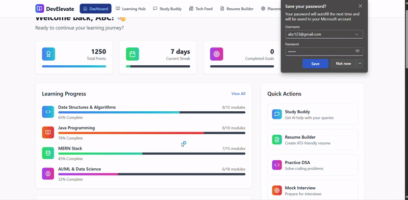

*Fig. 5.6: Frame of the repository screen recording of the authentication flow*

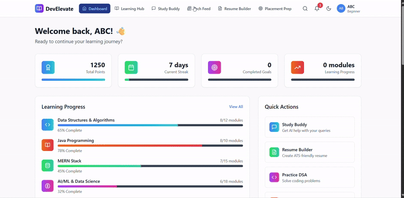

*Fig. 5.7: Later frame of the repository screen recording of the authentication flow*

# CHAPTER – 6

## RESULT AND TESTING

### 6.1   Evaluation Approach

The repository contains no automated test suite: the server manifest defines a test script that reports the absence of tests, and the client manifest defines no test script and no test runner is configured. The evaluation reported in this chapter was therefore carried out manually, by a combination of five techniques that are described below, each of which produces evidence that can be inspected and repeated.

. Source-level verification. The complete source of both applications was read and the declared behaviour of every route, controller, model and middleware was recorded. This establishes what the system contains, independently of whether it runs.

. Static analysis. Every server file was submitted to the parser of the Node.js runtime, and the client was submitted to the TypeScript compiler in checking mode. This establishes whether the code is syntactically and structurally well formed.

. Execution of the deployed client. The deployed application was loaded in a headless Chromium browser, the rendered text of each public route was extracted, screenshots were captured, the console output was recorded and the network failures were logged.

. Interaction testing. The authentication form was submitted with the demonstration credentials that the deployed login page itself publishes, and the result was observed both in the interface and in the console output.

. Local build execution. The development server was started from the repository and the served routes were requested, which exposed a failure of the client build that is described in Section 6.3.

No claim of a pass rate, a response time, a concurrency figure or a user count is made in this chapter, because none of these was measured. Where a subsystem could not be exercised, the corresponding test case is marked Not tested, and the reason is given.

### 6.2   Test Environment

**Table 6.1: Environment used for the evaluation**

| Item | Configuration |
| --- | --- |
| Workstation | Windows host with a 64-bit processor; Node.js runtime with the package manager of the distribution |
| Browser | Chromium-based browser in headless mode for the automated capture, at a viewport of 1600 by 1000 pixels |
| Client | Served from the deployed host; and separately from a local development server bound to a loopback port |
| Server | Inspected statically and submitted to the runtime parser; the server package was not started because the environment provides no database instance and no third-party credentials |
| Database | No live instance was available; persistence was verified at the level of the schema declarations and the query construction |

### 6.3   Results of the Static Analysis

The syntax check of the server was executed over every JavaScript file of the package with the parser of the runtime. The result is unambiguous: all 107 files parse without error, which confirms that the server package is syntactically complete and that no file contains an unresolved conflict marker.

The type check of the client, by contrast, fails. The compiler reports unresolved merge-conflict markers in twelve files of the client source: six components under the landing page, namely the call to action, the footer, the creator page, the disclaimer, the documentation page, the privacy policy and the terms of service, together with five duplicates of those components under the legal directory and one further duplicate. The conflict markers are the remnants of an unresolved version-control merge, and their presence means that the client cannot be type-checked, cannot be built and cannot be served by the development server. This was confirmed by observation: the local development server starts and reports that it is ready, but every route it serves returns the overlay of the bundler's parse error, naming the footer component and the call to action component.

The defect is not confined to the failing files, because the failing files are imported by the landing page, which is imported by the application root, which is imported by the entry point. The consequence is that the entire client is unservable in its current state, including the routes that would otherwise be reachable without a session. This is the single most significant finding of the evaluation and it is the reason why the authenticated screens of the application could not be captured from a local build and were captured from the deployment instead.

### 6.4   Test Cases and Observed Results

Table 6.2 records the test cases that were executed, the action performed, the expected and the observed result and the status. The status vocabulary is the following: Pass, when the observed result corresponded to the expected result; Fail, when it did not; Partially verified, when the observation established part of the expectation only; and Not tested, when the case could not be exercised in the available environment.

**Table 6.2: Test cases, expected and observed results**

| Test ID | Feature | Action or input | Expected result | Observed result | Status |
| --- | --- | --- | --- | --- | --- |
| TC-01 | Public landing page | Request the root path of the deployed host and capture the rendered text | The marketing page renders with its feature grid and call to action | The page rendered; the extracted text contains the hero heading, the statistics band and the feature sections | Pass |
| TC-02 | Sign-in screen | Request the sign-in path and capture the rendered text | The credential form, the Google sign-in control and the registration link are present | All four elements were present in the extracted text; the screen also displays plain-text demonstration administrator credentials | Pass |
| TC-03 | Route protection on the client | Request the dashboard, quiz, coding, community, résumé, learning and chatbot paths of the deployed host | Each request is redirected to the sign-in page while no session is established | All seven requests were redirected to the sign-in path and the rendered text was identical to the sign-in screen | Pass |
| TC-04 | Credential authentication | Submit the demonstration credentials published by the sign-in page | The session is established and the dashboard is rendered | The request was rejected; the console recorded a response with an undefined user and reported the condition that the user was not found; the application remained on the sign-in page | Fail |
| TC-05 | Input validation on the sign-in form | Observe the pattern attribute of the e-mail field | The address is validated against a well-formed pattern | The console reported that the pattern attribute is not a valid regular expression, because the expression is delimited by slashes inside the attribute value; the field therefore performs no client-side validation | Fail |
| TC-06 | Local development server | Start the development server and request the root and the sign-in paths | The application shell is served | The server started and reported readiness, but both requests returned the bundler's parse-error overlay, caused by unresolved merge-conflict markers in two of the landing-page components | Fail |
| TC-07 | Client type checking | Run the TypeScript compiler in checking mode over the client project | No type errors are reported | The compiler reported syntax errors arising from unresolved merge-conflict markers in twelve files of the client source | Fail |
| TC-08 | Server syntax integrity | Submit every server file to the runtime parser | Every file parses | All 107 files parsed without error | Pass |
| TC-09 | Administration route protection | Inspect the declaration of the administration feedback route group | Every operation in the group requires an identity and the administrator role | No protection is declared on the listing, review-status and delete operations of the group | Fail |
| TC-10 | Course authoring route protection | Inspect the declaration of the course write routes | The identity is established and the role is checked | Only the role check is declared; because the role is read from the identity that the absent identity check would have populated, the routes answer 403 in all cases and the feature is inoperative | Fail |
| TC-11 | Unauthenticated access to the compiler | Inspect the declaration of the compiler route | The route is protected | No protection is declared; the endpoint is open to anonymous use | Fail |
| TC-12 | Unauthenticated access to the conversational route | Inspect the declaration of the conversational route | The route is protected | No protection is declared on the conversational route, although the two generative routes in the same group are protected | Fail |
| TC-13 | Note liking | Trace the like route against the schema of the note | The like is recorded and the count is returned | The route reads and writes a field that the schema does not declare and assigns to a virtual property that has no setter, so the handler reaches its catch block and returns 500 | Fail |
| TC-14 | Socket authentication | Trace the handshake middleware against the claims issued by the authentication paths | The socket is bound to the authenticated user | The handshake resolves the user from a claim that the issued tokens do not carry, the lookup raises a cast error and the connection is admitted with a null user | Fail |
| TC-15 | Bearer token attachment on the client | Compare the storage key read by the request interceptor with the key written by the session provider | The interceptor attaches the token to every outgoing request | The two use different capitalisations of the same key, so the interceptor normally finds no session and no token is attached | Fail |
| TC-16 | Contest leaderboard scoring | Inspect the scoring rule and the rating utility | Points are awarded by difficulty with a penalty for previous failures and the rating is recomputed | The rule awards 100, 200 and 300 points for the three difficulty levels and adds twenty minutes per previous failure; the rating follows the Elo form with a constant of 32 | Pass |
| TC-17 | Contest submission flow | Exercise a submission | The submission is graded and broadcast to the room | No contest could be exercised: the server package was not started and no compiler credential is available | Not tested |
| TC-18 | Quiz attempt | Answer and submit a quiz | The attempt is scored and stored | No attempt could be exercised: the server package was not started | Not tested |
| TC-19 | Skill assessment generation | Request a generated assessment | Items are generated and stored, and the evaluation returns a score | The generation path requires the model credential and a database; neither was available | Not tested |
| TC-20 | Conversational assistant | Send a message to the Study Buddy | A reply is returned and rendered | The path requires the provider credential and a database; neither was available. The deployed application returned an authentication failure before reaching this module | Not tested |
| TC-21 | Résumé export | Export a completed résumé | A PDF document is produced in the browser | The export is implemented entirely in the browser and depends on a document library rather than on the server; the component was inspected but the export was not executed in the available environment | Not tested |
| TC-22 | Résumé scanner | Scan a résumé | A coverage report is returned | The scan requires the server; the deterministic keyword comparison itself was verified by inspection of the three keyword utilities | Not tested |
| TC-23 | Placement statistics | Request the placement endpoints | Statistics are returned from a database | The endpoints return a constant object declared inside the route file; no persistence is involved | Partially verified |
| TC-24 | Documentation pages | Request the documentation and contributor pages | Both pages render | Both rendered and their text was extracted, as shown in Figures 5.4 and 5.5 | Pass |
| TC-25 | Interface documentation accuracy | Compare the published endpoint list with the mounted route table | The published list corresponds to the mounted routes | The published list corresponds in substance, but omits the two duplicated mounts, the unauthenticated groups and the separate document-generation service on the second port | Partially verified |
| TC-26 | Credential exposure | Inspect the client build configuration and the server source | No provider credential is delivered to the browser and no secret is committed | Two provider credentials are inlined into the client bundle by the build tool and one credential and one signing secret appear as literals in the source | Fail |

The summary of the execution is as follows. Six cases passed, of which four are checks on the public deployment, one is the integrity check of the server source and one is the correctness of the contest scoring rule as verified against the implementation. Thirteen cases failed, and the failures cluster in four families: unresolved merge-conflict markers in the client source, protection that is declared incorrectly or not at all on the server, drift between a route and the schema it writes to, and secrets that are committed to the repository or delivered to the browser. Five cases could not be exercised and are marked as not tested, and two were verified in part. No case is reported as passed on the basis of the presence of a menu entry or of a screen.

### 6.5   Defects and Security Findings

The defects discovered during the evaluation are consolidated below with a severity and a proposed correction. They are reported in full because a project report that conceals the faults of the system it describes is of little value.

**Table 6.3: Defects and security findings**

| Ref | Finding | Effect | Proposed correction | Severity |
| --- | --- | --- | --- | --- |
| D-01 | Twelve client files contain unresolved merge-conflict markers | The client cannot be built, type-checked or served; the application is entirely unservable from the repository | Resolve the merges, keep one copy of each duplicated legal component and remove the other | Critical |
| D-02 | The administrator feedback route group declares no protection | Any visitor can list, modify and delete the feedback of all users | Apply the identity and administrator middleware to the group | High |
| D-03 | The conversational, compiler and scanner routes declare no protection | The provider credentials are consumed on behalf of anonymous callers | Apply the identity middleware and add a per-caller rate limit | High |
| D-04 | Two provider credentials are inlined into the client bundle | Every visitor can extract and use the credentials at the provider's expense | Proxy the calls through the server, as the conversational path already does | High |
| D-05 | A news service credential and a signing secret are committed to the source | The credentials are disclosed with every clone of the repository | Move them to the environment, rotate them, and purge them from the history | High |
| D-06 | The request interceptor and the session provider use different storage keys | The bearer token is not attached to the outgoing requests, so the authenticated features of the client fail against a server that requires it | Use one constant for the key in both places | Critical |
| D-07 | The socket handshake resolves the user from a claim that the issued tokens do not carry | The real-time channel carries no authenticated identity | Resolve the user from the same set of claim names that the REST middleware accepts, and reject the handshake when the token is invalid | High |
| D-08 | The like route and the note schema disagree on the field names, and the virtual count has no setter | The like operation always fails with a 500 | Declare the field in the schema, or change the route to use the declared field and a setter for the virtual | Medium |
| D-09 | The course write routes apply the role check without the identity check | The course authoring feature is inoperative and returns 403 | Apply the identity middleware before the role middleware | Medium |
| D-10 | The system-log creation route requires an identity but not the administrator role | Any signed-in user may write to the audit trail | Apply the administrator check | Medium |
| D-11 | The session cookie declares the secure attribute unconditionally | The session cannot be established over plain HTTP, which breaks local development | Derive the attribute from the environment | Low |
| D-12 | The application trusts forwarded protocol headers unconditionally | The address-based logic of the rate limiter can be defeated behind an uncooperative proxy | Trust the proxy only in a deployment environment | Low |
| D-13 | The client is not code-split and the route table imports every screen statically | The initial bundle carries the whole application, including three components of more than fifty kilobytes | Load the routed screens lazily and split the vendor libraries into separate chunks | Medium |
| D-14 | No error boundary is declared in the client | A rendering exception leaves the application without an interface | Add an error boundary at the shell and at the administration branch | Medium |
| D-15 | The validator module is not attached to any route | The request bodies are accepted without structural validation | Attach the validation middleware to the mutating routes | Medium |
| D-16 | Dead code: an unrouted placement-statistics page of about fifty-three kilobytes, an unrouted task board, six duplicated legal components, an empty utility file, an empty schema file and three orphan schemas | The size of the code base and the difficulty of reviewing it are increased without benefit | Remove the dead code or route it | Low |
| D-17 | The dashboard seeds a demonstration user and the recent-attempts panel is mapped from a commented-out block | The statistics row shows demonstration values and the attempts panel is always empty | Bind the panel to the session state and restore the mapping | Medium |
| D-18 | Duplicate mounts of the assessment and conversational route groups | The second prefix is unreachable and the documented interface is wider than the effective one | Remove the duplicate mounts | Low |

### 6.6   Limitations of the Evaluation

- No database instance was available, so the server package was not started and no endpoint that requires persistence was exercised. The server was therefore verified by inspection and by syntax analysis rather than by execution.

- No third-party credentials were available, so no inference, compiler, video or news integration was exercised end to end.

- The client could not be built or served from the repository because of the merge-conflict markers, so all client evidence was obtained from the deployed host, which necessarily represents the last successful build rather than the current source.

- The authenticated screens of the application could not be captured, because the demonstration credentials published by the deployed sign-in page are not accepted by the backend that the deployment is configured to use. The evidence supplied with this project, which shows a dashboard with populated statistics panels and with errors in some of the data panels, is consistent with the code-level findings of Sections 6.3 and 6.5, but it could not be reproduced independently during this evaluation, and no claim is made here that any dashboard panel was observed to work.

- No performance measurement was performed, and no figure for response time, throughput, concurrency or availability is asserted anywhere in this report.

### 6.7   Discussion

The evaluation supports three conclusions. The first is that the system is substantially complete as a design and as an implementation: the module set is broad, the layering is consistent, the data model is coherent, the external integrations are implemented against real interfaces rather than mocked, and the server code is of production quality in its structure and its error handling.

The second is that the principal obstacles to the system's operation are configurational rather than architectural. Of the eighteen findings, the critical and high-severity ones are a merge that was never completed, a mismatch between two storage keys, four route groups that omit the protection their data requires, a token claim that the real-time layer does not recognise, and three credentials that are exposed. Each of these is a matter of a few lines, and none of them requires a change to the architecture of Chapter 4.

The third is that the project's most ambitious claims are the least supported by the evidence. The platform's value proposition rests on the consolidation of learning, assessment and career preparation, and three of the modules that complete that proposition, namely the placement statistics, the dashboard aggregations and the cover-letter workflow, are served by static or client-local data. The honest statement of the result is therefore that Elevora AI is a well-structured platform with a working skeleton and a substantial set of implemented services, which requires a consolidation pass over its configuration and its credentials before it can be presented as the unified environment that the problem statement of Section 1.2 describes.

# CONCLUSION

This report has described the design, the implementation and the evaluation of Elevora AI, a full-stack web application that consolidates structured learning, timed assessment, code practice, documentation and career preparation behind a single authenticated and role-based interface. The work began with the observation that the technology student is obliged to assemble a learning workflow from separate services, and that no component of that workflow can report on the learner's overall progress because each of them holds only its own record.

The implemented system meets that observation with a substantial engineering response. The client is a single-page application of nineteen learner modules and nine administration modules, written in TypeScript and built with Vite, with an embedded code workspace, a conversational assistant, a résumé builder with an applicant-tracking-system scanner and a cover-letter generator. The server is an Express application of thirty route modules, twenty-four controllers and thirty-two MongoDB schemas, offering JWT authentication with e-mail one-time-password verification and Google sign-in, role-based authorisation, four learning-track route groups, quiz authoring and attempts, generative assessment with a stored evaluation, community moderation, a note system with file attachments, video progress, notifications, an administration console with analytics and an audit trail, and a contest subsystem that executes submitted code, applies a difficulty-based scoring rule with penalties, recomputes an Elo rating and broadcasts live updates over a socket channel. Three language models are integrated, each for the task to which it is best suited.

The evaluation was deliberately adversarial towards the project's own claims. The server source parses completely, but twelve files of the client contain unresolved merge-conflict markers, so that the client cannot currently be built or served from the repository. Four route groups on the server omit the access control their data requires, one of which permits anonymous deletion of user feedback. The real-time channel admits connections without establishing an identity. The client and the server refer to the session under two different storage keys, so that authenticated requests are sent without a token. Two provider credentials are compiled into the browser bundle and two more appear as literals in the source. The practice workspace addresses the compiler at a literal local address and therefore cannot work in a deployment. The dashboard seeds a demonstration user, and the placement module is served from a constant. The cover-letter module has no server counterpart, and the payment facility that the project synopsis describes has no server implementation at all. The authenticated screens of the application could not be captured, because the deployed build rejects the demonstration credentials that its own sign-in page publishes.

These findings are reported rather than smoothed away, because the value of the project is as a working piece of software that others are invited to contribute to, and a report that concealed the faults would misrepresent both the software and the community that inherits it. The corrections required are enumerated in Table 6.3 and are, with two exceptions, a matter of tens of lines rather than of redesign.

### Future Enhancements   None

The following improvements follow directly from the gaps identified during the inspection and the evaluation. They are listed in the order in which they would most usefully be undertaken.

. Resolve the outstanding merges in the client source, remove the duplicated legal components, and restore a clean build so that the type check, the lint check and the production bundle all pass.

. Introduce a single source of truth for the session storage key and for the token claim names, so that the client, the route middleware and the socket handshake agree, and introduce an automated test that asserts the agreement.

. Complete the access control matrix: apply the identity and role middleware to every route group that lacks it, add the ownership test to the note, progress, review and attempt resources, and record the resulting matrix as a specification artefact.

. Move all provider access behind the server, including the two calls that are currently made from the browser, remove the committed credentials from the source, and rotate the keys that were exposed.

. Replace the static placement data, the dashboard seed values and the mock course catalogue with persisted records, so that the three modules that complete the platform's central proposition rest on the database.

. Implement the cover-letter workflow on the server, with storage, retrieval, a plain variant for machine parsing and an assessment of the letter against the target role, so that the two career-document modules become symmetric.

. Either implement a server-side subscription with the payment provider, or remove the subscription screens, so that the interface does not advertise a facility that the platform cannot honour.

. Introduce code splitting for the routed screens and an error boundary at the application shell, which together address the two client defects that most affect the experience of a first-time visitor.

. Establish an automated test suite, beginning with the route middleware and the utility functions, which are the parts of the system that the inspection identified as most defective and which are the cheapest to test in isolation.

. Extend the assessment engine with item review and distractor analysis, and record the agreement between the generated evaluation and a human evaluation on a sample of attempts, so that the reported skill levels can be interpreted with an understanding of their reliability.

. Add an explicit deployment guide that records the required environment variables, the proxy rule that the client and the server require in order to share an origin, and the order in which the two applications must be brought up, since the absence of such a document is the likely origin of several of the defects recorded in Chapter 6.

# REFERENCES

**[1]** *Fielding, R. T.* "Architectural Styles and the Design of Network-based Software Architectures", Doctoral dissertation, Chapter 5: Representational State Transfer (REST), University of California, Irvine, 2000. Available at: https://www.ics.uci.edu/~fielding/pubs/dissertation/rest_arch_style.htm

**[2]** *Django Software Foundation.* "Django 5.0 Documentation", Consulted for the repository, template and object-relational mapping conventions compared in Section 2.2. Available at: https://docs.djangoproject.com/en/5.0/

**[3]** *OpenJS Foundation.* "Express — Node.js Web Application Framework, Version 5 Documentation", Available at: https://expressjs.com/en/guide/routing.html

**[4]** *MongoDB Inc.* "Mongoose 8.x Documentation — Schemas, Models and Middleware", Available at: https://mongoosejs.com/docs/

**[5]** *OpenJS Foundation.* "jsonwebtoken — JSON Web Token Implementation for Node.js", Available at: https://github.com/auth0/node-jsonwebtoken

**[6]** *Sandhu, R. S., Coyne, E. J., Feinstein, H. L. and Youman, C. E.* "Role-Based Access Control Models", IEEE Computer, vol. 29, no. 2, pp. 38-47, February 1996. Cited in Section 2.5 as the origin of the role-based model applied in Sections 3.2 and 4.6.

**[7]** *Hamari, J., Koivisto, J. and Sarsa, H.* "Does Gamification Work? A Literature Review of Empirical Studies on Gamification", Proceedings of the 47th Hawaii International Conference on System Sciences (HICSS-47), 2014. Cited in Section 2.6.

**[8]** *Mollick, E. R. and Mollick, L.* "Using AI to Implement Effective Teaching Strategies in Classrooms: Five Strategies, Including Prompts", SSRN Electronic Journal, 2023. Available at: https://papers.ssrn.com/sol3/papers.cfm?abstract_id=4323286

**[9]** *Pinto, G., Steinmacher, I. and Gerosa, M. A.* "More Common Than You Think: An In-depth Study of Casual Contributors", Proceedings of the 23rd IEEE International Conference on Software Analysis, Evolution and Reengineering (SANER), 2016, pp. 199-208. Cited in Section 2.8.

**[10]** *Elo, A. E.* "The Rating of Chess Players, Past and Present", Arco Publishing, New York, 1978. The basis of the rating computation implemented in Server/utils/ratingCalculator.js and described in Section 5.13.

**[11]** *Judge0 Ltd. and the Judge0 open-source contributors.* "Judge0 — Open Source Code and CPU Judge", Available at: https://judge0.com/ and https://github.com/judge0/judge0

**[12]** *Google.* "Gemini API — Generative Language API Documentation, v1beta Models Endpoint", Available at: https://ai.google.dev/gemini-api/docs

**[13]** *OpenAI.* "OpenAI API Reference — Chat Completions", Available at: https://platform.openai.com/docs/api-reference/chat

**[14]** *Groq, Inc.* "Groq API Documentation — OpenAI-compatible Inference Endpoint", Available at: https://console.groq.com/docs

**[15]** *Socket.IO Inc.* "Socket.IO 4.x Documentation — Rooms and Broadcasting", Available at: https://socket.io/docs/v4/

**[16]** *Meta Platforms, Inc. and contributors.* "React 18 — A JavaScript Library for Building User Interfaces", Available at: https://react.dev/ and https://react.dev/blog/2022/03/29/react-v18

**[17]** *You, E. and contributors.* "Vite — Next Generation Frontend Tooling", Available at: https://vitejs.dev/guide/

**[18]** *Wathan, A. and contributors.* "Tailwind CSS — A Utility-First CSS Framework", Available at: https://tailwindcss.com/docs

**[19]** *Microsoft Corporation.* "Monaco Editor — The Editor That Powers Visual Studio Code", Available at: https://microsoft.github.io/monaco-editor/

**[20]** *The Firebase Team.* "Firebase Authentication — Sign in with Google", and the Firebase JavaScript SDK documentation. Available at: https://firebase.google.com/docs/auth

**[21]** *Auth0, Inc.* "JSON Web Token (JWT) — RFC 7519", Available at: https://jwt.io/

**[22]** *Nodemailer.* "Nodemailer — Email Sending Library for Node.js", Available at: https://nodemailer.com/

**[23]** *Google Developers.* "YouTube Data API v3 Documentation", Available at: https://developers.google.com/youtube/v3/docs

**[24]** *NewsAPI.* "NewsAPI — Top Headlines Endpoint Documentation", Available at: https://newsapi.org/docs

**[25]** *Stripe, Inc.* "Stripe — Payment Links and Checkout Documentation", Consulted in relation to the subscription module described in Sections 3.3 and 5.15. Available at: https://docs.stripe.com/

**[26]** *Mozilla Foundation and contributors.* "MDN Web Docs — Fetch API, Web Storage and Regular Expressions", Available at: https://developer.mozilla.org/

**[27]** *The OpenJS Foundation and contributors.* "Express, Node.js and Socket.IO — Documentation and Release Notes", Consulted for the versions and the middleware semantics recorded in Table 3.4.

**[28]** *MrAlpha00.* "Dev-Elevate — Elevora AI Project Repository", GitHub, 2025. The software described in this report. Available at: https://github.com/MrAlpha00/Dev-Elevate
